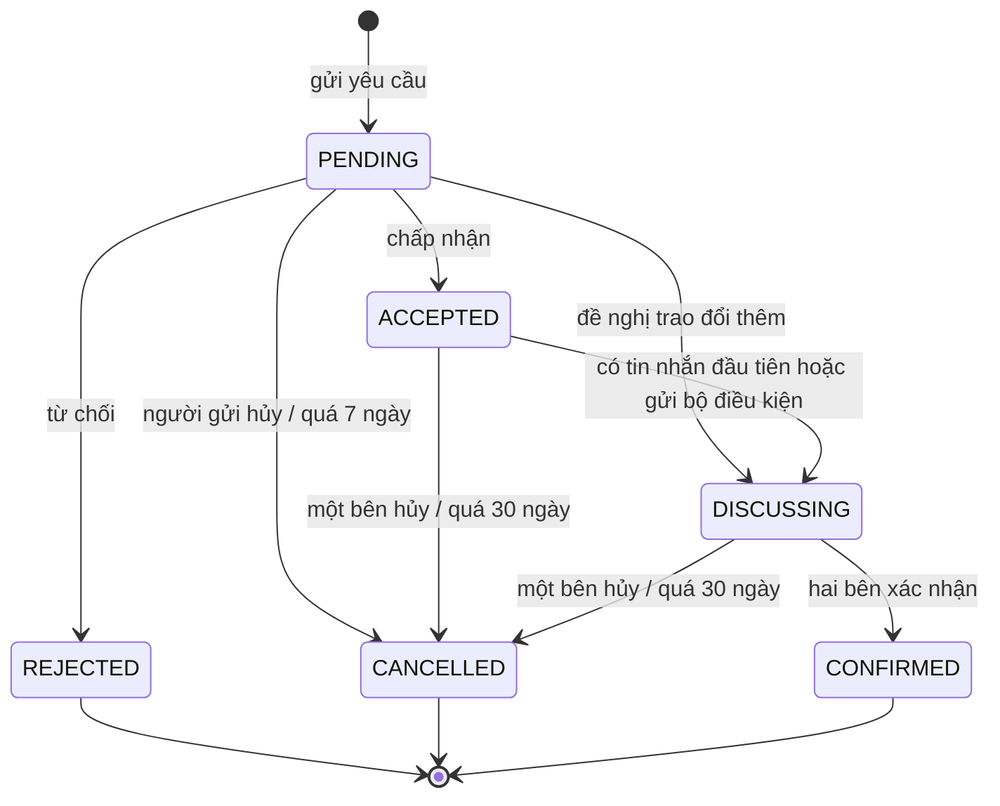
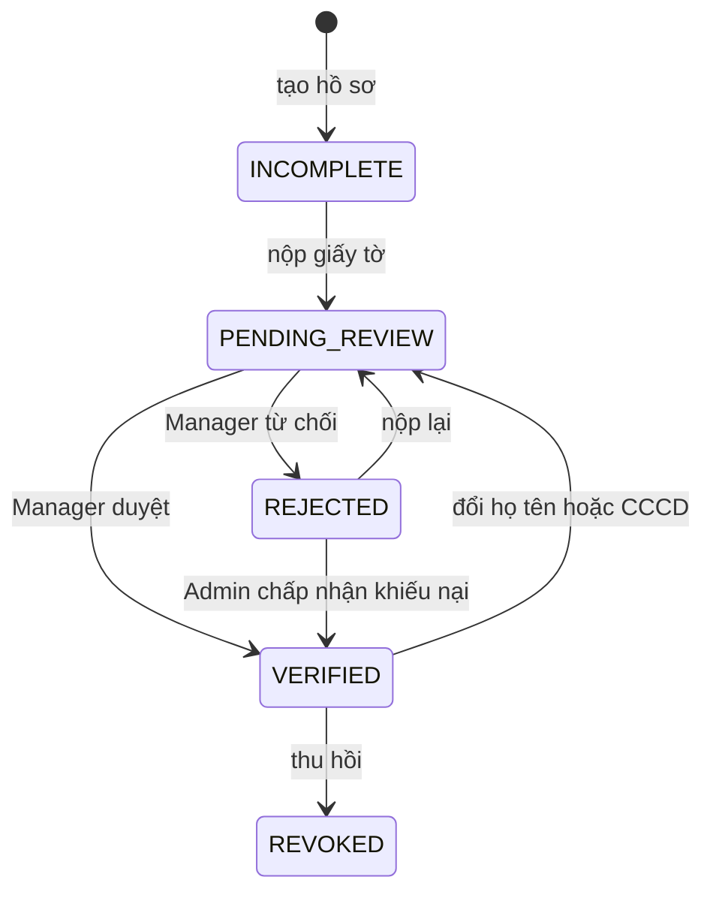
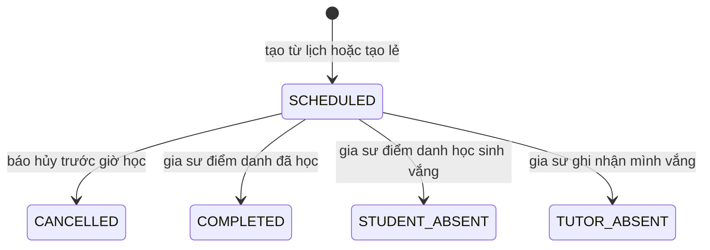
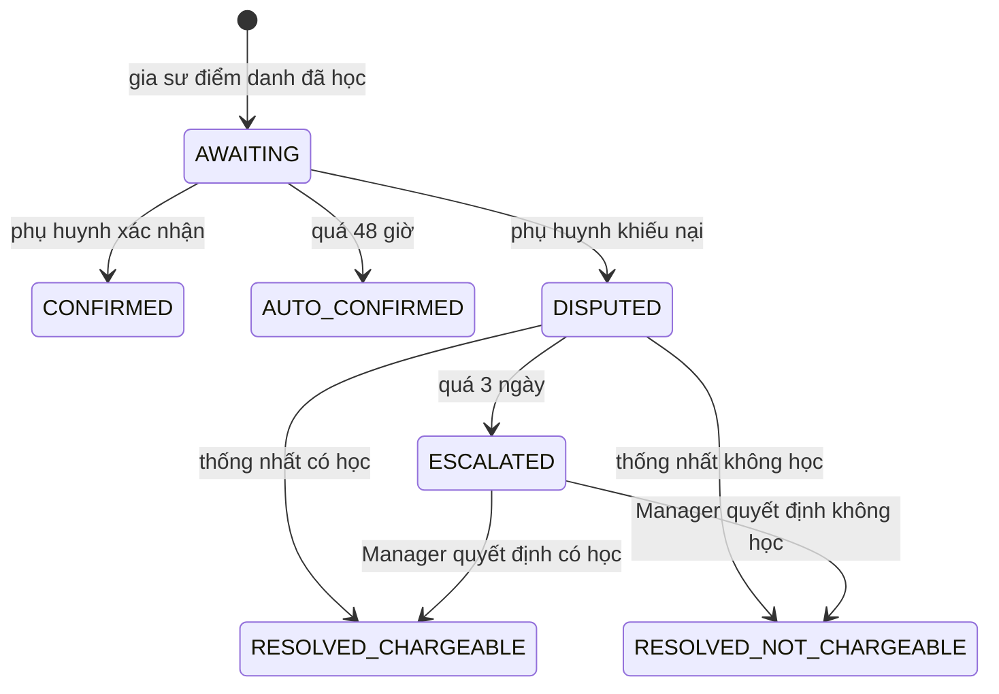
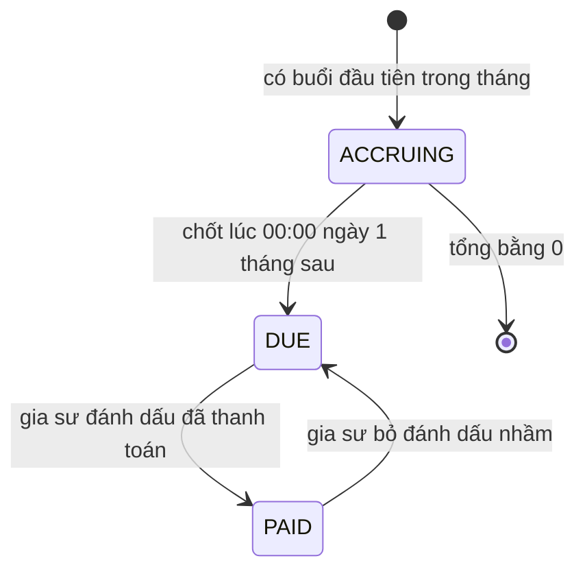

# Máy trạng thái

Tài liệu này mô tả vòng đời của yêu cầu kết nối, hồ sơ xác minh, buổi học và khoản học phí. Mọi chuyển trạng thái không có trong bảng đều bị từ chối, và mọi chuyển trạng thái đều được ghi lịch sử gồm người thực hiện và thời điểm.

Mã `BR-xxx` trỏ tới [business-rules.md](business-rules.md); quy tắc nào là đề xuất thì được đánh dấu `ĐX` ở đó. Các mốc thời gian dùng giờ Việt Nam (`Asia/Ho_Chi_Minh`). Hành động của **Hệ thống** do Worker chạy theo lịch.

## 1. Yêu cầu kết nối

| Trạng thái | Tên trong PRD | Kết thúc? |
| --- | --- | --- |
| `PENDING` | Chờ phản hồi | Không |
| `ACCEPTED` | Đã chấp nhận | Không |
| `DISCUSSING` | Đang trao đổi | Không |
| `CONFIRMED` | Đã xác nhận hợp tác | Có |
| `REJECTED` | Đã từ chối | Có |
| `CANCELLED` | Đã hủy | Có |

| Từ | Đến | Ai thực hiện | Điều kiện | Tác động | Quy tắc |
| --- | --- | --- | --- | --- | --- |
| (mới) | `PENDING` | Phụ huynh hoặc gia sư đã xác minh | Có hồ sơ học sinh; không có yêu cầu trùng đang mở; gia sư đã xác minh | Thông báo cho bên nhận | BR-206, BR-401, BR-402, BR-406 |
| `PENDING` | `ACCEPTED` | Bên nhận | | Mở chat; thông báo | BR-501, BR-502 |
| `PENDING` | `DISCUSSING` | Gia sư là bên nhận | | Mở chat; thông báo | BR-503 |
| `PENDING` | `REJECTED` | Bên nhận | | Thông báo | |
| `PENDING` | `CANCELLED` | Bên gửi | | Thông báo | |
| `PENDING` | `CANCELLED` | Hệ thống | Quá 7 ngày | Thông báo hai bên | BR-403 |
| `ACCEPTED` | `DISCUSSING` | Hệ thống | Có tin nhắn đầu tiên hoặc một bên gửi bộ điều kiện | | |
| `ACCEPTED`, `DISCUSSING` | `CANCELLED` | Một trong hai bên | | Chat chỉ đọc; thông báo | BR-508 |
| `ACCEPTED`, `DISCUSSING` | `CANCELLED` | Hệ thống | Quá 30 ngày kể từ lúc rời `PENDING`, tin nhắn mới không gia hạn; đã nhắc trước 3 ngày | Chat chỉ đọc; thông báo | BR-404, BR-411, BR-508 |
| `DISCUSSING` | `CONFIRMED` | Hệ thống, sau khi hai bên xác nhận | Hai xác nhận cùng trỏ tới một bộ điều kiện | Tạo quan hệ dạy học, lớp, lịch; mở số điện thoại và email; thông báo | BR-407, BR-409, BR-504 |

Ba thao tác tạo quan hệ dạy học, tạo lớp và đổi sang `CONFIRMED` phải nằm trong cùng một giao dịch. Nếu một bên sửa bộ điều kiện, trạng thái vẫn là `DISCUSSING` nhưng xác nhận trước đó bị hủy (BR-408).

## 2. Hồ sơ xác minh gia sư

| Trạng thái | Tên hiển thị | Được hiển thị công khai? |
| --- | --- | --- |
| `INCOMPLETE` | Chưa hoàn thiện | Không |
| `PENDING_REVIEW` | Chờ xác minh | Không |
| `VERIFIED` | Đã xác minh | Có |
| `REJECTED` | Bị từ chối | Không |
| `REVOKED` | Đã thu hồi | Không |

PRD §3.2 có ba trạng thái đầu. `REJECTED` cần thiết theo C4. `REVOKED` là đề xuất, dùng khi phát hiện giấy tờ giả sau khi đã duyệt.

| Từ | Đến | Ai thực hiện | Điều kiện | Tác động | Quy tắc |
| --- | --- | --- | --- | --- | --- |
| `INCOMPLETE` | `PENDING_REVIEW` | Gia sư | Đã nộp CCCD và ảnh chân dung cầm CCCD; sinh viên nộp thêm thẻ sinh viên | Tính hạn 2 ngày làm việc | BR-201, BR-202, BR-204 |
| `PENDING_REVIEW` | `VERIFIED` | Manager | Từ 18 tuổi; CCCD không trùng tài khoản khác | Lưu giá trị băm CCCD; hồ sơ được công khai; hẹn xóa ảnh sau 30 ngày; thông báo | BR-204, BR-207, BR-215, BR-217 |
| `PENDING_REVIEW` | `REJECTED` | Manager | Có lý do | Hẹn xóa ảnh sau 30 ngày; thông báo | BR-205, BR-208 |
| `REJECTED` | `PENDING_REVIEW` | Gia sư | Nộp giấy tờ mới | Hủy lịch xóa ảnh cũ nếu giấy tờ còn dùng | BR-205 |
| `REJECTED` | `VERIFIED` | Admin | Chấp nhận khiếu nại, trong lúc ảnh còn lưu | Như khi duyệt; ghi nhật ký | BR-1202 |
| `VERIFIED` | `PENDING_REVIEW` | Hệ thống | Gia sư đổi họ tên hoặc nộp CCCD khác | Ẩn khỏi công khai cho đến khi duyệt xong | BR-209 |
| `VERIFIED` | `REVOKED` | Admin | Có lý do | Ẩn hồ sơ và bài đăng; xử lý lớp đang học theo báo cáo vi phạm; thông báo | BR-1204 |

Khi gia sư không còn ở `VERIFIED`, các lớp đang học không tự kết thúc. Admin quyết định theo từng trường hợp.

Xác minh danh tính không hết hạn, nên không có chuyển trạng thái theo thời gian từ `VERIFIED` (BR-211). Nhãn sinh viên được xử lý riêng và hết hạn nhãn không làm đổi trạng thái xác minh (BR-212, BR-213).

## 3. Buổi học

Một buổi có hai trục độc lập: trạng thái buổi học và trạng thái xác nhận. "Học bù" không phải là trạng thái; đó là buổi mới có liên kết tới buổi gốc (BR-607).

### 3.1. Trạng thái buổi học

| Từ | Đến | Ai thực hiện | Điều kiện | Tác động | Quy tắc |
| --- | --- | --- | --- | --- | --- |
| (mới) | `SCHEDULED` | Hệ thống hoặc gia sư | Lớp đang học | Lưu giá tại thời điểm tạo | BR-804 |
| `SCHEDULED` | `CANCELLED` | Gia sư hoặc phụ huynh | Trước giờ học; dưới 2 tiếng thì gắn `late_cancel` | Thông báo; không tính tiền | BR-603, BR-604, BR-605 |
| `SCHEDULED` | `COMPLETED` | Gia sư | Sau giờ bắt đầu | Mở xác nhận 48 giờ; có thể tính tiền | BR-606, BR-608 |
| `SCHEDULED` | `STUDENT_ABSENT` | Gia sư | Sau giờ bắt đầu; có thể gắn `no_notice` | Không tính tiền | BR-604, BR-605, BR-606 |
| `SCHEDULED` | `TUTOR_ABSENT` | Gia sư | Sau giờ bắt đầu | Không tính tiền | BR-604, BR-606 |

Nếu gia sư chưa điểm danh sau 7 ngày, buổi vẫn ở `SCHEDULED`, được gắn cờ và không tính tiền (BR-610). Phụ huynh không tự điểm danh; nếu gia sư ghi sai, phụ huynh dùng khiếu nại.

Gia sư được sửa giữa `COMPLETED`, `STUDENT_ABSENT` và `TUTOR_ABSENT` trong 48 giờ khi buổi chưa chốt; hệ thống lưu lịch sử và tính lại 48 giờ (BR-612). Sau khi lớp kết thúc, gia sư còn 7 ngày để điểm danh các buổi đã qua (BR-613).

### 3.2. Xác nhận buổi đã học

Chỉ áp dụng cho buổi `COMPLETED`.

| Từ | Đến | Ai thực hiện | Điều kiện | Tác động | Quy tắc |
| --- | --- | --- | --- | --- | --- |
| `AWAITING` | `CONFIRMED` | Phụ huynh | Trong 48 giờ | Buổi được tính tiền | BR-608 |
| `AWAITING` | `AUTO_CONFIRMED` | Hệ thống | Quá 48 giờ; đã nhắc một lần | Buổi được tính tiền | BR-608, BR-609 |
| `AWAITING` | `DISPUTED` | Phụ huynh | Trong 48 giờ; có lý do | Tạm chưa tính tiền; thông báo gia sư | BR-701 |
| `DISPUTED` | `RESOLVED_CHARGEABLE` | Phụ huynh rút khiếu nại | Trong 3 ngày | Buổi được tính tiền | BR-702 |
| `DISPUTED` | `RESOLVED_NOT_CHARGEABLE` | Gia sư sửa điểm danh | Trong 3 ngày | Buổi đổi sang trạng thái vắng tương ứng; không tính tiền | BR-702 |
| `DISPUTED` | `ESCALATED` | Hệ thống | Quá 3 ngày | Tạo việc cho Manager | BR-702 |
| `ESCALATED` | `RESOLVED_CHARGEABLE`, `RESOLVED_NOT_CHARGEABLE` | Manager | Có lý do | Sửa bản ghi; thông báo hai bên | BR-702, BR-703 |
| `RESOLVED_CHARGEABLE`, `RESOLVED_NOT_CHARGEABLE` | Trạng thái còn lại | Admin | Khiếu nại lại; có lý do | Sửa bản ghi; có thể điều chỉnh tháng sau | BR-704, BR-808 |

Buổi **đã chốt** là buổi ở `CONFIRMED`, `AUTO_CONFIRMED` hoặc `RESOLVED_CHARGEABLE`. Chỉ các buổi này được cộng vào học phí.

## 4. Khoản học phí

Nền tảng chỉ ghi nhận, không có giao dịch tiền thật trong MVP (BR-802).

| Trạng thái | Ý nghĩa | Sửa được số tiền? |
| --- | --- | --- |
| `ACCRUING` | Đang cộng dồn trong tháng | Hệ thống tự tính |
| `DUE` | Đã chốt, cần thanh toán | Không; chênh lệch ghi vào tháng sau |
| `PAID` | Gia sư đã ghi nhận nhận tiền | Không |

| Từ | Đến | Ai thực hiện | Điều kiện | Tác động | Quy tắc |
| --- | --- | --- | --- | --- | --- |
| (mới) | `ACCRUING` | Hệ thống | Có buổi đã chốt đầu tiên của lớp trong tháng | | BR-803 |
| `ACCRUING` | `DUE` | Hệ thống | 00:00 ngày 1 tháng sau; tổng lớn hơn 0 | Thông báo học phí đến hạn | BR-801, BR-805 |
| `ACCRUING` | Bỏ khoản | Hệ thống | 00:00 ngày 1 tháng sau; tổng bằng 0 | | BR-803 |
| `DUE` | `PAID` | Gia sư | | Tạo bản ghi thanh toán thủ công; thông báo phụ huynh | BR-806 |
| `PAID` | `DUE` | Gia sư | Có lý do | Hủy bản ghi thanh toán; ghi nhật ký; thông báo phụ huynh | BR-807 |

Buổi diễn ra cuối tháng 10 nhưng chốt sau 00:00 ngày 1 tháng 11 sẽ vào khoản tháng 11. Việc này xảy ra thường xuyên vì hạn xác nhận là 48 giờ. Bảng học phí vì vậy phải hiện ngày của từng buổi để phụ huynh đối chiếu (BR-805).

Chưa có trạng thái thanh toán một phần hay quá hạn trong MVP, vì PRD §3.12 chỉ yêu cầu đã thanh toán và chưa thanh toán.
