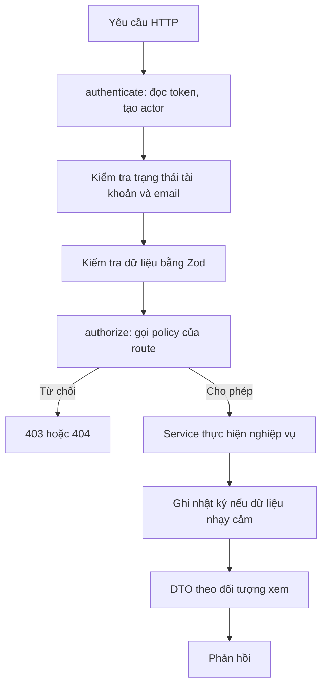

# Thiết kế phân quyền

Tài liệu này mô tả cách triển khai [ma trận phân quyền](../01-requirements/roles-permissions.md) trên Express. Đây là phần cần làm kỹ nhất của backend, vì một lỗi ở đây có thể làm lộ dữ liệu trẻ em. Đây là đề xuất thiết kế, chờ duyệt.

## Nguyên tắc

1. **Mặc định từ chối.** Route không khai báo quyền thì không chạy được.
2. **Tập trung một nơi.** Mọi quyết định nằm trong module `policies`, không viết rải rác trong service hay controller.
3. **Kiểm tra từ cơ sở dữ liệu.** Không tin ID chủ sở hữu, vai trò hay quan hệ do client gửi.
4. **Lọc ở cả ba tầng.** Tài nguyên đơn lẻ dùng policy; danh sách dùng truy vấn có phạm vi; trường dữ liệu dùng DTO theo đối tượng xem.
5. **Lỗi thì từ chối.** Không kiểm tra được quyền hoặc không ghi được nhật ký thì không trả dữ liệu.

## Luồng xử lý một yêu cầu



## Actor

`authenticate` tạo đối tượng `actor` cho mỗi yêu cầu:

```ts
type Actor =
  | { kind: 'guest' }
  | { kind: 'user'; userId: string; role: Role; tutorVerified: boolean };
```

- `role`, `tutorVerified` và trạng thái tài khoản được đọc từ cơ sở dữ liệu ở mỗi yêu cầu, không lấy từ token. Token chỉ dùng để biết `userId`.
- Nhờ vậy tài khoản bị khóa hoặc gia sư bị thu hồi xác minh mất quyền ngay, tốt hơn mục tiêu 15 phút của NFR-S04. Việc này thêm một truy vấn theo khóa chính cho mỗi yêu cầu.
- Tài khoản chưa xác thực email chỉ được gọi các endpoint của chính tài khoản (AC-ACC-02.2).

## Khai báo route

Route bắt buộc khai báo policy qua một hàm bọc. TypeScript báo lỗi khi thiếu, và có test quét toàn bộ route để chắc chắn không có route nào đi vòng qua.

```ts
defineRoute({
  method: 'POST',
  path: '/connection-requests/:id/accept',
  input: acceptRequestSchema,
  policy: connectionPolicy.respond,
  handler: acceptRequest,
});

defineRoute({
  method: 'GET',
  path: '/public/tutors',
  input: searchTutorsSchema,
  policy: publicAccess,
  output: publicTutorDto,
  handler: searchTutors,
});
```

`publicAccess` là cách duy nhất để mở một route cho khách. Danh sách route công khai vì vậy tìm và rà soát được dễ dàng.

## Các điều kiện quan hệ

Mỗi điều kiện ở ma trận được hiện thực bằng đúng một hàm. Các hàm này là phần duy nhất biết cách đọc quan hệ, và luôn có bộ lọc xóa mềm.

| Điều kiện | Truy vấn trên [mô hình dữ liệu](data-model.md) |
| --- | --- |
| `SELF` | Cột chủ sở hữu của tài nguyên bằng `actor.userId` |
| `GUARDIAN` | `students.guardian_user_id = actor` và học sinh chưa xóa |
| `STUDENT` | `students.user_id = actor` và học sinh chưa xóa |
| `TEACHING` | Có `teaching_relationships` với `tutor_id = actor`, đúng `student_id`, `ended_at IS NULL` |
| `TAUGHT` | Như trên nhưng `ended_at IS NOT NULL`, và học sinh chưa qua `purge_after`. Chỉ đọc; học sinh đã xóa thì ẩn tên (BR-1309) |
| `PARTY` | `connection_requests.tutor_id` hoặc `parent_id` bằng actor; với chat là có dòng `conversation_participants` |
| `CONFIRMED` | Yêu cầu ở `confirmed` và lớp liên quan chưa `ended` |
| `ASSIGNED` | `assigned_manager_id = actor` trên đúng hồ sơ, báo cáo hoặc tranh chấp, và hồ sơ đang mở |

Quyền của gia sư theo quan hệ luôn theo cặp gia sư và học sinh, và với dữ liệu lớp thì phải đúng lớp đó. Gia sư dạy Toán không xem được kết quả môn Văn của cùng học sinh do gia sư khác dạy (AC-LRN-02.5).

## Policy

Mỗi hàng của ma trận là một hàm policy nhận `actor` và tài nguyên, trả kết quả có lý do:

```ts
type Decision =
  | { allow: true }
  | { allow: false; reveal: boolean; code: string };

// Quyết định đọc kết quả học tập.
async function canReadResults(actor: Actor, classId: string, studentId: string) {
  if (actor.kind !== 'user') return deny({ reveal: false });
  if (actor.role === 'parent') return guardianOf(actor, studentId);
  if (actor.role === 'student') return isStudent(actor, studentId);
  if (actor.role === 'tutor') return teachesOrTaught(actor, classId, studentId);
  return deny({ reveal: false });
}
```

- `reveal: false` trả **404** để không lộ tài nguyên tồn tại, dùng khi người gọi không có quan hệ gì với nó.
- `reveal: true` trả **403** khi người gọi đã biết tài nguyên, ví dụ bên gửi cố chấp nhận yêu cầu của chính mình.
- Điều kiện theo trạng thái, ví dụ "chỉ `pending` mới chấp nhận được", nằm ở máy trạng thái và trả 409, không nằm ở policy.

## Danh sách

Policy theo từng dòng không phù hợp với danh sách vì chậm và dễ lộ tổng số. Mỗi repository vì vậy có hàm truy vấn đã giới hạn phạm vi, nhận `actor` là tham số bắt buộc:

```ts
lessonsVisibleTo(actor, filters)
```

Hàm này thêm điều kiện phạm vi vào SQL trước khi áp dụng bộ lọc của client. Không có API repository nào đọc danh sách mà không nhận `actor`, trừ các hàm dành riêng cho Worker.

## Lọc trường bằng DTO

Mỗi tài nguyên có DTO riêng theo đối tượng xem, theo [bảng hiển thị theo trường](../01-requirements/roles-permissions.md#hiển-thị-theo-trường-dữ-liệu):

| DTO | Đối tượng | Không bao giờ có |
| --- | --- | --- |
| `PublicTutorDto` | Khách, tìm kiếm, SSR | Họ tên đầy đủ, trường, đơn vị công tác, điện thoại, email |
| `PartyTutorDto` | Đang kết nối | Họ tên đầy đủ, điện thoại, email |
| `ConfirmedTutorDto` | Đã xác nhận, lớp chưa kết thúc | Giấy tờ, số CCCD |
| `RequestPostForTutorDto` | Gia sư xem bài tìm gia sư | Họ tên, trường, địa chỉ, điện thoại của trẻ và phụ huynh |

DTO được dựng bằng cách liệt kê trường cho phép. Không trả thẳng entity TypeORM và không dùng cách loại bỏ trường, để một cột mới không tự động lộ ra ngoài.

## Dữ liệu nhạy cảm

Giấy tờ, tin nhắn bị báo cáo và hồ sơ trẻ khi Manager, Admin xem đi qua một hàm chung:

```ts
await auditedRead(actor, { action: 'verification.document.view', target }, () => signUrl(file));
```

- Nhật ký được ghi trước khi trả dữ liệu; ghi lỗi thì từ chối (BR-1206, AC-VER-02.2).
- Manager đọc tin nhắn bị báo cáo từ `report_message_snapshots`, không đọc từ `messages`. Vai trò Manager không có đường truy cập tới hội thoại đầy đủ (AC-MOD-02.1).
- Admin chỉ xem được khi có khiếu nại đang xử lý (AC-MOD-04.2).

## Tệp

Quyền đọc tệp phụ thuộc vào `files.purpose`. URL ký chỉ được tạo sau khi policy của mục đích đó cho phép.

| `purpose` | Ai đọc được | Thời hạn URL |
| --- | --- | --- |
| `avatar` | Theo quyền xem hồ sơ | 15 phút |
| `verification_document` | Chủ hồ sơ, Manager `ASSIGNED`, Admin khi có khiếu nại | 5 phút |
| `message_image` | `conversation_participants` | 15 phút |

## Socket

- Xác thực khi bắt tay bằng cùng cơ chế token, và kiểm tra trạng thái tài khoản.
- Vào phòng `conversation:{id}` phải qua policy của `conversations`. Client không tự chọn phòng người dùng khác.
- Mỗi người dùng tự động có phòng cá nhân `user:{id}` cho thông báo.
- Khi khóa tài khoản, chặn người dùng, hủy yêu cầu hoặc kết thúc lớp, hệ thống ngắt socket hoặc rời phòng ngay (AC-ACC-03.6, AC-MSG-02.1).

## Worker và hệ thống

Worker không đi qua HTTP nên không có `actor` người dùng. Nó dùng `systemActor` riêng, chỉ được thực hiện các chuyển trạng thái có ghi "Hệ thống" trong máy trạng thái. Lịch sử ghi `actor_user_id` bằng null.

## Phòng thủ nhiều lớp ở cơ sở dữ liệu

| Biện pháp | Có làm trong MVP? |
| --- | --- |
| Tài khoản ứng dụng chỉ có quyền tối thiểu; không có `UPDATE`, `DELETE` trên `audit_logs` | Có |
| Tài khoản migration tách khỏi tài khoản ứng dụng | Có |
| Row-Level Security của PostgreSQL | Chưa |

Row-Level Security bảo vệ tốt hơn nhưng phức tạp khi dùng với TypeORM và connection pool, vì phải đặt ngữ cảnh người dùng cho từng giao dịch. Tôi đề xuất chưa dùng trong MVP và xem lại trước khi mở rộng.

## Kiểm thử

| Loại test | Nội dung |
| --- | --- |
| Theo bảng | Một bảng test sinh ra từ ma trận: mỗi hàng được chạy với mọi vai trò, có và không có quan hệ |
| Bắt buộc | 13 tình huống ở [roles-permissions.md](../01-requirements/roles-permissions.md#các-trường-hợp-bắt-buộc-có-test) chạy trên API thật và cơ sở dữ liệu thật |
| Quét route | Mọi route có policy; danh sách route công khai khớp với danh sách đã duyệt |
| Quét DTO | Snapshot danh sách trường của từng DTO; đổi trường phải được rà soát |
| Socket | Người ngoài không vào được phòng; bị khóa thì bị ngắt |
| Nhật ký | Xem dữ liệu nhạy cảm tạo đúng bản ghi; ghi nhật ký lỗi thì từ chối |

CI chặn merge nếu các test này không đạt (NFR-S01). Bất kỳ thay đổi nào trong `policies`, DTO công khai hoặc danh sách route công khai cần người thứ hai rà soát.
