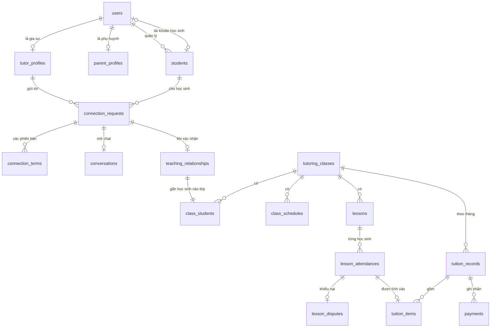

# Thiết kế dữ liệu

Tài liệu này mô tả mô hình dữ liệu PostgreSQL cho MVP ở mức bảng, cột chính và ràng buộc. Toàn bộ là đề xuất thiết kế, chờ chủ sản phẩm và đội kỹ thuật duyệt. Migration thực tế sẽ viết theo tài liệu này ở giai đoạn code.

Nguồn yêu cầu: [quy tắc nghiệp vụ](../01-requirements/business-rules.md), [máy trạng thái](../01-requirements/state-machines.md), [phân quyền](../01-requirements/roles-permissions.md).

## Quy ước

| Hạng mục | Quy ước |
| --- | --- |
| Tên | `snake_case`, tên bảng số nhiều |
| Khóa chính | UUID v7 sinh ở ứng dụng; bảng nối dùng khóa ghép |
| Thời gian | `timestamptz`, lưu UTC; ngày thuần dùng `date` |
| Tiền | `bigint`, số nguyên VND, hậu tố `_vnd` |
| Trạng thái | `text` kèm `CHECK`, không dùng enum của PostgreSQL, để thêm giá trị bằng migration đơn giản (expand và contract) |
| Mọi bảng nghiệp vụ | Có `created_at`, `updated_at` |
| Xóa | Chỉ `users` và các bảng được ghi rõ có `deleted_at`; xem [Lưu trữ và xóa dữ liệu](#lưu-trữ-và-xóa-dữ-liệu) |
| Extension | `citext`, `pg_trgm`, `unaccent`; chưa cần PostGIS (D11) |

Hai tên khác với PRD §8 để tránh nhầm lẫn: `Class` thành `tutoring_classes`, `Report` thành `violation_reports`.

## Tổng quan quan hệ

## Tài khoản

### `users`

| Cột | Kiểu | Ghi chú |
| --- | --- | --- |
| `id` | uuid | Khóa chính |
| `email` | citext | Unique khi `deleted_at IS NULL` |
| `email_verified_at` | timestamptz | Null là chưa xác thực |
| `password_hash` | text | Argon2id |
| `display_name` | text | |
| `phone` | text | Tùy chọn, tự khai (BR-108) |
| `avatar_file_id` | uuid | Tham chiếu `files` |
| `locale` | text | `vi`, `en` |
| `status` | text | `active`, `temporarily_locked`, `locked` |
| `deleted_at` | timestamptz | Có giá trị là đã xóa (BR-1301) |
| `purge_after` | timestamptz | `deleted_at` + 6 tháng (BR-1302) |

### Các bảng khác

| Bảng | Cột chính | Ràng buộc và ghi chú |
| --- | --- | --- |
| `user_roles` | `user_id`, `role` | Khóa ghép. `role`: `tutor`, `parent`, `student`, `manager`, `admin`. MVP cho phép một vai trò mỗi tài khoản ở tầng ứng dụng (BR-102); để bảng nối vì PRD §2 có thể mở nhiều vai trò. |
| `user_sessions` | `user_id`, `family_id`, `refresh_token_hash`, `expires_at`, `rotated_at`, `revoked_at` | Mỗi refresh token một dòng. Unique `refresh_token_hash`. `rotated_at` có giá trị mà token vẫn được gửi lại nghĩa là bị dùng lại; khi đó dùng `family_id` để thu hồi cả chuỗi (AC-ACC-03.4). |
| `rate_limit_events` | `bucket`, `occurred_at` | Đếm số lần thử theo cửa sổ thời gian (NFR-S05). `bucket` là giá trị băm nên bảng không chứa email. Worker xóa dòng cũ hơn 1 ngày. |
| `one_time_tokens` | `user_id`, `purpose`, `token_hash`, `payload`, `expires_at`, `used_at` | `purpose`: `verify_email`, `reset_password`, `change_email`, `student_invite`. Chỉ lưu băm. |
| `consents` | `user_id`, `document`, `version`, `accepted_at`, `student_id` | `student_id` có giá trị khi phụ huynh đồng ý thay cho con (NFR-P04). |
| `system_settings` | `key`, `value`, `updated_by` | Gồm cờ tài khoản học sinh, mặc định tắt (BR-107). |

## Hồ sơ và danh mục

| Bảng | Cột chính | Ràng buộc và ghi chú |
| --- | --- | --- |
| `tutor_profiles` | `user_id`, `legal_name`, `tutor_type`, `organization`, `introduction`, `experience`, `teaching_method`, `price_per_lesson_vnd`, `lesson_minutes`, `teaching_modes`, `accepting_students`, `verification_status`, `student_label_expires_at` | Khóa chính `user_id`. `verification_status` theo máy trạng thái mục 2. `price_per_lesson_vnd` > 0 (BR-810). |
| `tutor_subjects`, `tutor_grades`, `tutor_regions` | `tutor_id` cùng `subject_id`, `grade_id`, `region_id` | Khóa ghép; phục vụ bộ lọc tìm kiếm. |
| `tutor_availability` | `tutor_id`, `weekday`, `start_time`, `end_time` | `CHECK start_time < end_time`. |
| `tutor_credentials` | `tutor_id`, `verification_request_id`, `title`, `status` | Huy hiệu bằng cấp (BR-203). |
| `parent_profiles` | `user_id`, `region_id` | Khóa chính `user_id`. |
| `students` | `id`, `guardian_user_id`, `user_id`, `nickname`, `full_name`, `grade_id`, `deleted_at` | Xem ghi chú bên dưới. |
| `subjects`, `grades` | `id`, `name_vi`, `name_en`, `is_active` | Hai tên đều bắt buộc. Chỉ tắt, không xóa (AC-MOD-05.2). |
| `regions` | `id`, `code`, `parent_id`, `level`, `name_vi`, `name_en`, `is_active` | Unique `code`. Cấp tỉnh và xã (D11). |
| `files` | `id`, `owner_user_id`, `purpose`, `bucket`, `object_key`, `mime_type`, `size_bytes`, `deleted_at` | `purpose` quyết định bucket và quyền đọc. |

**Về bảng `students`:**

- `guardian_user_id` là một khóa ngoại trực tiếp vì mỗi học sinh chỉ có một phụ huynh (C9). Bảng `StudentGuardian` nhiều-nhiều đề xuất trong báo cáo Giai đoạn 1 không còn cần.
- `guardian_user_id` cho phép null để mở cho người học trưởng thành sau này (D3). Trong MVP, ứng dụng bắt buộc phải có giá trị.
- `user_id` cho phép null và unique: học sinh tồn tại không cần tài khoản (D4, BR-109).
- Không có cột ngày sinh và địa chỉ nhà (NFR-P01). Khi có ngưỡng tuổi, cần xem lại bảng này.

## Bài đăng

| Bảng | Cột chính | Ràng buộc và ghi chú |
| --- | --- | --- |
| `tutor_posts` | `tutor_id`, `title`, `content`, `subject_id`, `grade_id`, `teaching_mode`, `region_id`, `price_per_lesson_vnd`, `capacity`, `starts_on`, `status`, `moderated_hidden_at`, `view_count`, `deleted_at` | `status`: `draft`, `recruiting`, `full`, `paused`, `hidden`, `closed`. `moderated_hidden_at` tách riêng để chủ bài không tự bỏ ẩn được (AC-MOD-03.3). |
| `tutor_request_posts` | `parent_id`, `student_id`, `subject_id`, `goal`, `teaching_mode`, `region_id`, `budget_vnd`, `desired_schedule`, `starts_on`, `requirements`, `description`, `status`, `moderated_hidden_at` | `status`: `open`, `hidden`, `closed`. Không chứa cột định danh trẻ; phần còn lại lấy qua `student_id` và kiểm soát ở DTO (BR-304). |

## Kết nối

| Bảng | Cột chính | Ràng buộc và ghi chú |
| --- | --- | --- |
| `connection_requests` | `direction`, `tutor_id`, `parent_id`, `student_id`, `subject_id`, `source_tutor_post_id`, `source_request_post_id`, `message`, `status`, `left_pending_at`, `reminded_at`, `reject_reason` | Xem ràng buộc bên dưới. `left_pending_at` là mốc tính 30 ngày, không đổi khi có tin nhắn (Q4). |
| `connection_events` | `request_id`, `from_status`, `to_status`, `actor_user_id`, `occurred_at` | Chỉ thêm, không sửa. `actor_user_id` null là hệ thống. |
| `connection_terms` | `request_id`, `version`, `subject_id`, `grade_id`, `teaching_mode`, `price_per_lesson_vnd`, `lesson_minutes`, `schedule`, `starts_on`, `created_by` | Unique `(request_id, version)`. Chỉ thêm, không sửa; sửa là tạo phiên bản mới (AC-CON-04.4). `schedule` là JSON. |
| `connection_confirmations` | `terms_id`, `user_id`, `confirmed_at` | Khóa ghép. Hợp tác xác nhận khi phiên bản mới nhất có đủ xác nhận của hai bên (BR-407, BR-408). |

**Ràng buộc quan trọng của `connection_requests`:**

- Unique một phần trên `(tutor_id, student_id, subject_id)` với `status IN ('pending', 'accepted', 'discussing')`. Cơ sở dữ liệu sẽ chặn yêu cầu trùng kể cả khi gửi đồng thời (BR-406, AC-CON-01.3).
- `CHECK` hai cột bài đăng nguồn không cùng có giá trị.
- Index một phần cho Worker: `(status, created_at)` với `pending`, và `(status, left_pending_at)` với `accepted`, `discussing`.

## Lớp và buổi học

| Bảng | Cột chính | Ràng buộc và ghi chú |
| --- | --- | --- |
| `teaching_relationships` | `tutor_id`, `student_id`, `source_request_id`, `started_at`, `ended_at` | Unique `source_request_id`, nên xác nhận lại không tạo trùng (AC-CON-05.2). Căn cứ quyền `TEACHING`, `TAUGHT` và đánh giá sau này. |
| `tutoring_classes` | `tutor_id`, `name`, `subject_id`, `grade_id`, `teaching_mode`, `goal`, `initial_assessment`, `price_per_lesson_vnd`, `lesson_minutes`, `starts_on`, `status`, `paused_at`, `ended_at`, `ended_by`, `end_reason` | `status`: `active`, `paused`, `ended`. |
| `class_students` | `class_id`, `student_id`, `relationship_id`, `joined_at`, `left_at` | Khóa ghép `(class_id, student_id)`. Unique `relationship_id`. Bảng nối cho phép lớp nhóm về sau (D7); MVP giới hạn một học sinh ở tầng ứng dụng. |
| `class_schedules` | `class_id`, `weekday`, `start_time`, `minutes`, `valid_from`, `valid_to`, `generated_until` | Quy tắc lặp. Sửa từ một buổi trở đi là đóng dòng cũ và mở dòng mới. |
| `lessons` | `class_id`, `schedule_id`, `original_starts_at`, `starts_at`, `minutes`, `teaching_mode`, `status`, `cancelled_by`, `cancelled_at`, `cancel_reason`, `is_late_cancel`, `makeup_of_lesson_id`, `content_taught`, `actual_minutes` | `status`: `scheduled`, `held`, `cancelled`. Unique `(schedule_id, original_starts_at)` để job sinh buổi chạy lại không trùng (AC-TCH-02.1). Unique `makeup_of_lesson_id` (AC-TCH-04.1). |
| `lesson_attendances` | `lesson_id`, `student_id`, `status`, `is_no_notice`, `price_vnd`, `confirmation_status`, `confirmation_deadline`, `reminded_at`, `confirmed_at` | Khóa ghép. Xem ghi chú bên dưới. |
| `attendance_revisions` | `lesson_id`, `student_id`, `old_status`, `new_status`, `changed_by`, `changed_at`, `reason` | Chỉ thêm (BR-612). |
| `lesson_disputes` | `lesson_id`, `student_id`, `opened_by`, `reason`, `status`, `negotiate_until`, `assigned_manager_id`, `decision`, `decided_by`, `decided_at`, `decision_reason` | Unique `(lesson_id, student_id)`. Giữ `negotiate_until` = lúc mở + 3 ngày (BR-702). |
| `price_change_proposals` | `class_id`, `proposed_by`, `new_price_vnd`, `effective_from`, `status`, `decided_by`, `decided_at` | Lưu lịch sử đổi giá (BR-602). |

**Điểm danh tách theo từng học sinh.** PRD ghi buổi học có thông tin điểm danh, nhưng lớp nhóm cần một bản ghi cho mỗi học sinh (D7). Vì vậy máy trạng thái mục 3 được ánh xạ như sau:

| Trạng thái trong máy trạng thái | Lưu ở đâu |
| --- | --- |
| `SCHEDULED`, `CANCELLED` | `lessons.status` = `scheduled`, `cancelled` |
| `COMPLETED`, `STUDENT_ABSENT`, `TUTOR_ABSENT` | `lessons.status` = `held` và `lesson_attendances.status` = `completed`, `student_absent`, `tutor_absent` |
| `AWAITING`, `CONFIRMED`, `AUTO_CONFIRMED`, `DISPUTED`, `ESCALATED`, `RESOLVED_*` | `lesson_attendances.confirmation_status` |

`price_vnd` là giá chụp lại tại thời điểm dạy (BR-804). Lớp 1-1 có đúng một dòng cho mỗi buổi.

## Theo dõi học tập

| Bảng | Cột chính | Ràng buộc và ghi chú |
| --- | --- | --- |
| `assessments` | `class_id`, `student_id`, `title`, `assessed_on`, `score`, `score_scale`, `comment`, `context`, `created_by` | `score` là `numeric(5,2)`, cho phép null. `CHECK score BETWEEN 0 AND score_scale`, mặc định thang 10 (BR-904). |
| `assessment_revisions` | `assessment_id`, `old_values`, `changed_by`, `changed_at` | Chỉ thêm (BR-906). |

Mục tiêu và đánh giá ban đầu nằm trong `tutoring_classes` ở MVP. Bảng `LearningGoal` đề xuất trong báo cáo Giai đoạn 1 sẽ tạo khi có mục tiêu theo tháng, học kỳ.

## Học phí

| Bảng | Cột chính | Ràng buộc và ghi chú |
| --- | --- | --- |
| `tuition_records` | `class_id`, `student_id`, `period_month`, `status`, `amount_vnd`, `closed_at` | Unique `(class_id, student_id, period_month)`. `period_month` là ngày 1 của tháng. `status`: `accruing`, `due`, `paid`. |
| `tuition_items` | `record_id`, `kind`, `lesson_id`, `student_id`, `amount_vnd`, `dispute_id`, `note` | `kind`: `lesson`, `adjustment`. Unique một phần `(lesson_id, student_id)` với `kind = 'lesson'`, nên một buổi không bị cộng trùng (AC-TUI-01.4). `amount_vnd` âm được khi là điều chỉnh. |
| `payments` | `record_id`, `method`, `amount_vnd`, `paid_on`, `recorded_by`, `voided_at`, `void_reason`, `provider`, `provider_ref` | `method`: `manual`; thêm `online` khi tích hợp cổng thanh toán. Unique một phần `record_id` với `voided_at IS NULL`, vì MVP chưa thanh toán một phần. |

Khoản đã `due` không đổi `amount_vnd`; thay đổi về sau là một dòng `adjustment` ở khoản tháng khác (BR-808). Phần tổng âm được chuyển sang tháng kế tiếp (AC-TUI-05.3).

## Trao đổi và thông báo

| Bảng | Cột chính | Ràng buộc và ghi chú |
| --- | --- | --- |
| `conversations` | `request_id`, `status`, `read_only_at`, `last_message_at` | Unique `request_id` (BR-511). `status`: `open`, `read_only`. |
| `conversation_participants` | `conversation_id`, `user_id`, `last_read_message_id` | Khóa ghép. Là căn cứ quyền đọc và kết nối socket. |
| `messages` | `conversation_id`, `sender_id`, `client_message_id`, `body`, `image_file_id`, `moderated_hidden_at`, `created_at` | Unique `(conversation_id, sender_id, client_message_id)` để gửi lại không trùng (AC-MSG-02.4). `CHECK` có `body` hoặc `image_file_id`. Index `(conversation_id, id DESC)` cho cursor. |
| `user_blocks` | `blocker_id`, `blocked_id`, `created_at` | Khóa ghép. |
| `notifications` | `user_id`, `type`, `data`, `dedupe_key`, `read_at` | Unique `(user_id, dedupe_key)` (AC-NOT-01.3). `data` không chứa nội dung tin nhắn. |
| `notification_preferences` | `user_id`, `category`, `email_enabled` | Khóa ghép. Email bảo mật không có dòng tắt (AC-NOT-04.1). |
| `device_tokens` | `user_id`, `platform`, `token`, `revoked_at` | Dùng khi ra Mobile (D2); tạo sau. |
| `outbox_events` | `type`, `aggregate_id`, `payload`, `occurred_at`, `attempts`, `next_attempt_at`, `processed_at`, `failed_at` | Ghi cùng giao dịch nghiệp vụ (NFR-R06). Thử tối đa 5 lần, sau đó ghi `failed_at` và cảnh báo. Index một phần với `processed_at IS NULL AND failed_at IS NULL`. Không chứa token: Worker tạo token khi gửi email. |

## Xác minh

| Bảng | Cột chính | Ràng buộc và ghi chú |
| --- | --- | --- |
| `verification_requests` | `tutor_id`, `kind`, `status`, `submitted_at`, `due_at`, `assigned_manager_id`, `decided_by`, `decided_at`, `reason`, `valid_until` | `kind`: `identity`, `student_label`, `credential`. Unique một phần `(tutor_id, kind)` với `status = 'pending_review'`. |
| `verification_documents` | `request_id`, `file_id`, `document_type`, `purge_after`, `purged_at` | `document_type`: `citizen_id_front`, `citizen_id_back`, `portrait_with_id`, `student_card`, `credential`. Worker xóa theo `purge_after` (BR-207, BR-208, BR-214). |
| `citizen_id_fingerprints` | `fingerprint`, `user_id`, `purge_after` | Unique `fingerprint`. Xem ghi chú bên dưới. |

**Về `citizen_id_fingerprints`:**

- `fingerprint` là HMAC-SHA-256 của số CCCD đã chuẩn hóa (BR-215). Khóa nằm trong trình quản lý bí mật, không nằm trong cơ sở dữ liệu, để số CCCD không dò ngược được nếu lộ cơ sở dữ liệu.
- Số CCCD gốc không được lưu ở bất kỳ đâu, kể cả log (AC-VER-02.8).
- Ràng buộc unique chặn trùng ngay cả khi hai Manager duyệt đồng thời.
- `purge_after` bằng null khi tài khoản bị khóa vì vi phạm (BR-218). Mốc này cần luật sư rà soát.

## Kiểm duyệt và nhật ký

| Bảng | Cột chính | Ràng buộc và ghi chú |
| --- | --- | --- |
| `violation_reports` | `reporter_id`, `target_type`, `target_id`, `reason`, `is_child_safety`, `description`, `status`, `assigned_manager_id`, `conclusion`, `conclusion_reason`, `concluded_at` | Index hàng chờ theo `(status, is_child_safety DESC, created_at)` (BR-1207). |
| `report_message_snapshots` | `report_id`, `message_id`, `sender_id`, `body`, `image_file_id`, `sent_at` | Bản sao tại lúc báo cáo: tin bị báo cáo và 10 tin mỗi phía (BR-1203, AC-MOD-01.3). Manager đọc từ đây, không đọc từ `messages`. |
| `appeals` | `subject_type`, `subject_id`, `appellant_id`, `reason`, `status`, `decided_by`, `decided_at`, `decision_reason` | Unique `(subject_type, subject_id)`: một lần khiếu nại cho mỗi kết luận (AC-MOD-04.1). |
| `audit_logs` | `actor_user_id`, `action`, `target_type`, `target_id`, `metadata`, `ip`, `occurred_at` | Chỉ thêm. Vai trò ứng dụng không có quyền `UPDATE`, `DELETE` trên bảng này (NFR-S08). `metadata` không chứa số CCCD hay nội dung tin nhắn. |

## Ngoài MVP

Các bảng sau chưa tạo. Mô hình hiện tại đã có điểm nối cho chúng.

| Bảng dự kiến | Khi nào | Điểm nối |
| --- | --- | --- |
| `assignments`, `submissions`, `learning_materials` | Ngay sau MVP (D10) | `tutoring_classes`, `students`, `files` |
| `reviews` | Ngay sau MVP (D10) | Unique `teaching_relationships.id` (BR-1002); điều kiện 1 tháng lấy từ `started_at` (BR-1001) |
| `learning_reports` | Sau MVP | `tutoring_classes`, `students` |
| `favorite_tutors` | MVP, nếu kịp (BR-005) | `users`, `tutor_profiles` |
| Gói dịch vụ, phí nền tảng | Khi thu phí (PRD §12 câu 12) | `users`, `payments.provider` |

## Lưu trữ và xóa dữ liệu

| Dữ liệu | Khi xóa tài khoản (`deleted_at`) | Sau 6 tháng (`purge_after`) |
| --- | --- | --- |
| `users`, `parent_profiles`, `tutor_profiles` | Ẩn ngay | Xóa thông tin cá nhân; giữ dòng `users` đã ẩn danh để không vỡ khóa ngoại |
| `students` | Ẩn cùng phụ huynh (BR-1304) | Xóa thông tin định danh |
| `files` của người dùng | Ngừng cấp URL | Xóa khỏi kho |
| `messages` | Hội thoại chỉ đọc | Xóa nội dung, ảnh |
| `tutoring_classes`, `lessons`, `tuition_records`, `assessments` | Giữ | Ẩn danh; xóa nội dung tự do (nhận xét, ghi chú) |
| `consents`, `audit_logs` | Giữ | Theo chính sách riêng; `audit_logs` lưu 12 tháng (NFR-S08) |
| `citizen_id_fingerprints` | Giữ | Xóa, trừ tài khoản bị khóa vì vi phạm (BR-218) |

Worker bỏ qua các tài khoản có báo cáo, tranh chấp hoặc khiếu nại đang mở (BR-1306). Bản sao lưu hết hạn sau 30 ngày (NFR-P06).

## Tìm kiếm

| Nhu cầu | Cách làm |
| --- | --- |
| Lọc gia sư | Index trên `tutor_profiles (verification_status, accepting_students, price_per_lesson_vnd, updated_at)` và trên các bảng `tutor_subjects`, `tutor_grades`, `tutor_regions` theo cột danh mục |
| Tìm không phân biệt dấu | Hàm `immutable_unaccent` và index GIN `pg_trgm` trên tên danh mục (AC-MKT-04.2) |
| Chỉ gia sư đã xác minh | Index một phần với `verification_status = 'verified'` |
| Đánh giá hiệu năng | Kiểm chứng NFR-F03 bằng 10.000 hồ sơ thử trước khi quyết định thêm bảng tổng hợp |

## Các quyết định liên quan

| Mã | Quyết định | Ảnh hưởng đến mô hình |
| --- | --- | --- |
| BR-1307 | Đăng ký lại được bằng email cũ trong 6 tháng | `users.email` chỉ unique khi `deleted_at IS NULL`. Khôi phục tài khoản phải kiểm tra email chưa có người dùng. |
| BR-1308 | Giữ bản ẩn danh để thống kê | Sau `purge_after`, dòng `users` và `students` không còn dữ liệu định danh, nhưng khóa ngoại vẫn nguyên. |
| BR-1309 | Gia sư xem lịch sử đã ẩn tên trong 6 tháng | DTO của gia sư ẩn tên khi `students.deleted_at` có giá trị. Quyền `TAUGHT` hết khi đã qua `purge_after`. |
