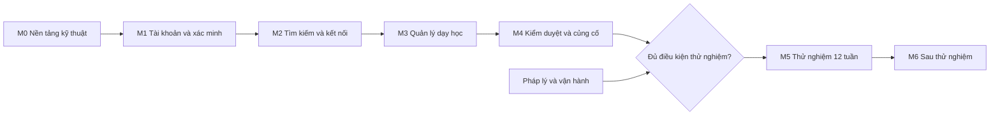

# Lộ trình triển khai

Bản này xác định thứ tự công việc, phụ thuộc và điều kiện qua từng mốc đến khi thử nghiệm MVP. Toàn bộ là đề xuất, chờ duyệt.

## Nguồn lực hiện tại

Chủ sản phẩm làm một mình, toàn thời gian, và tạm thời chưa có ngân sách (C13). Điều này dẫn đến:

| Hạng mục | Hệ quả | Cách làm đề xuất |
| --- | --- | --- |
| Thời gian | 18–25 tuần-người là khoảng 4–6 tháng nếu chỉ lập trình. Thực tế dài hơn vì cùng người đó còn lo pháp lý, tuyển gia sư, vận hành. Chưa đặt ngày ra mắt; sẽ hiệu chỉnh sau M1. | Đo tốc độ thực tế ở M0, M1 |
| Hạ tầng | M0 đến M3 chạy được trên máy cá nhân bằng Docker, gần như không tốn chi phí hạ tầng. | Chỉ thuê hạ tầng khi cần staging thật, muộn nhất ở M4 |
| Dịch vụ ngoài | Email và kho tệp được giả lập khi phát triển (Mailpit, SeaweedFS). | Chọn dịch vụ thật khi lên staging |
| Luật sư | Là điều kiện bắt buộc trước M5 (BR-1209) và chưa có nguồn chi. | Không được bỏ qua; cần có nguồn chi trước M5 |
| Tách vai Manager và Admin | Một người giữ cả hai vai thì khiếu nại lại không còn độc lập (BR-704). | Tìm thêm một người giữ vai Admin hoặc Manager trước M5 |

Một số điều kiện ở các mốc cần staging (M0, M4) được chuyển thành chạy trên môi trường cục bộ cho đến khi có hạ tầng. Việc kiểm chứng trên staging thật vẫn là điều kiện trước M5.

## Tổng quan

Thứ tự này theo PRD §13: tìm và kết nối trước, quản lý giảng dạy sau. Xác minh đứng trước tìm kiếm vì gia sư chưa xác minh không được hiển thị công khai (D5). Mobile nằm ở M6 (D2).

## Các mốc

Khối lượng dưới đây là ước lượng thô cho **một lập trình viên full-stack có kinh nghiệm, làm toàn thời gian**. Chúng chưa dựa trên tốc độ thực tế của đội và cần hiệu chỉnh sau M1.

| Mốc | Mục tiêu | Khối lượng (tuần-người) |
| --- | --- | --- |
| M0 | Khung API, Web, CI và phân quyền chạy được | 2–3 |
| M1 | Đăng ký, xác minh gia sư, trang công khai đầu tiên | 3–4 |
| M2 | Phụ huynh tìm thấy gia sư, kết nối và chat được | 5–7 |
| M3 | Tạo lớp, học, điểm danh, học phí | 5–7 |
| M4 | Kiểm duyệt, kiểm thử bảo mật, sẵn sàng vận hành | 3–4 |
| **Tổng đến thử nghiệm** | | **18–25** |

### M0: Nền tảng kỹ thuật

**Việc cần làm:**

- Khởi tạo `apps/api` và `apps/web`; thiết lập `.gitignore`, lint, format, kiểm tra kiểu.
- Docker cho PostgreSQL và Redis ở môi trường phát triển; migration đầu tiên.
- CI theo từng ứng dụng; chạy test và quét dependency.
- Khung route bắt buộc khai báo policy, DTO, lỗi theo chuẩn, nhật ký, sinh OpenAPI ([authorization.md](../03-architecture/authorization.md), [api-guidelines.md](../03-architecture/api-guidelines.md)).
- Khung SSR, hai ngôn ngữ, sinh client từ OpenAPI ở Web.
- Môi trường staging và sao lưu cơ sở dữ liệu.

**POC cần làm sớm:** `zod-to-openapi` với Express, và React Router SSR với cookie xác thực.

**Điều kiện qua mốc:**

- Một route mẫu chạy từ Web đến cơ sở dữ liệu trên môi trường cục bộ; làm lại trên staging khi có hạ tầng.
- Test quét route chặn được route thiếu policy.
- Khôi phục sao lưu thành công một lần.

**Chưa làm ở M0, vì chưa có hạ tầng:** môi trường staging, sao lưu tự động, image Docker cho API và Web. POC `zod-to-openapi` và SSR chuyển tiếp cookie đã đạt; phần đăng nhập thật sẽ kiểm chứng tiếp ở M1.

### M1: Tài khoản và xác minh

**Phạm vi:** [accounts.md](../01-requirements/use-cases/accounts.md) (trừ UC-ACC-07), [verification.md](../01-requirements/use-cases/verification.md), UC-MKT-01, UC-MKT-05, UC-MOD-05. Thêm email và thông báo trong app ở mức cần thiết (UC-NOT-01, UC-NOT-02).

**Điều kiện qua mốc:**

- Đạt tiêu chí nghiệm thu của các use case trên.
- Gia sư thật đi hết luồng từ đăng ký đến hồ sơ công khai trên staging.
- Số CCCD không xuất hiện trong cơ sở dữ liệu và log.

**Thứ tự làm:** mỗi lát chạy được từ Web đến cơ sở dữ liệu trước khi sang lát sau.

| Lát | Nội dung | Trạng thái |
| --- | --- | --- |
| 1 | Đăng ký, xác thực email, đăng nhập, phiên, quên mật khẩu (UC-ACC-01 đến 04); outbox, Worker và email ở mức cần cho các luồng này | Đang rà soát |
| 2 | Thông tin cá nhân, hồ sơ học sinh, kho tệp (UC-ACC-05, UC-ACC-06) | Đang rà soát |
| 3 | Danh mục, hồ sơ gia sư, trang gia sư công khai (UC-MOD-05, UC-MKT-01, UC-MKT-05) | Chưa làm |
| 4 | Xác minh gia sư (verification.md, UC-VER-01 đến 09) | Chưa làm |
| 5 | Thao tác Admin, xóa tài khoản, thông báo trong app (UC-ACC-08, UC-ACC-09, UC-NOT-01, UC-NOT-02) | Chưa làm |

Các phần phải đợi mốc sau:

- AC-ACC-03.6 mới đạt phần REST ở lát 1; phần ngắt socket làm cùng chat ở M2.
- AC-ACC-06.1, chặn gửi yêu cầu kết nối khi chưa có hồ sơ học sinh, làm cùng UC-CON-01 ở M2.
- Ngoại lệ không xóa được hồ sơ học sinh đang có lớp (UC-ACC-06) làm khi có lớp ở M3. Trước đó hồ sơ nào cũng xóa được.

### M2: Tìm kiếm và kết nối

**Phạm vi:** phần còn lại của [marketplace.md](../01-requirements/use-cases/marketplace.md), [connection.md](../01-requirements/use-cases/connection.md), [messaging.md](../01-requirements/use-cases/messaging.md), phần còn lại của [notifications.md](../01-requirements/use-cases/notifications.md). UC-MKT-07 làm nếu kịp.

UC-CON-05 ở mốc này mới dừng ở việc tạo được lớp; quản lý lớp thuộc M3.

**Điều kiện qua mốc:**

- Phụ huynh và gia sư đi hết cả hai chiều kết nối đến khi có lớp.
- Đạt NFR-F03 với 10.000 hồ sơ thử, và NFR-F05 cho chat.
- Bài tìm gia sư không truy cập được từ bên ngoài và không có trong sitemap.

**Nên cân nhắc:** cho một nhóm nhỏ gia sư và phụ huynh quen biết dùng thử trên staging bằng dữ liệu giả, để thu phản hồi trước khi làm M3.

### M3: Quản lý dạy học

**Phạm vi:** [teaching.md](../01-requirements/use-cases/teaching.md), [learning.md](../01-requirements/use-cases/learning.md), [tuition.md](../01-requirements/use-cases/tuition.md).

**Điều kiện qua mốc:**

- Một lớp chạy đủ một tháng bằng dữ liệu giả lập: sinh buổi, điểm danh, tự chốt, tranh chấp, chốt học phí.
- Job theo lịch chạy lại không tạo kết quả trùng (NFR-R04, NFR-R05).
- Các ranh giới 2 tiếng, 48 giờ, 00:00 ngày 1 đều có test.

### M4: Kiểm duyệt và củng cố

**Phạm vi:** phần còn lại của [moderation.md](../01-requirements/use-cases/moderation.md); UC-ACC-07 nếu đã có ngưỡng tuổi; xử lý xóa dữ liệu sau 6 tháng; hoàn thiện NFR.

**Điều kiện qua mốc:**

- 13 tình huống bắt buộc ở [roles-permissions.md](../01-requirements/roles-permissions.md#các-trường-hợp-bắt-buộc-có-test) đều đạt trên staging.
- Rà soát theo OWASP Top 10, xử lý hết lỗi nghiêm trọng (NFR-S10).
- Kiểm thử tải đạt NFR-F06; cảnh báo vận hành hoạt động (NFR-O03).

### M5: Thử nghiệm 12 tuần

Mục tiêu theo C13: 30 gia sư đã xác minh, 100 phụ huynh đăng ký, 20 lớp tạo từ kết nối, ít nhất 60% số lớp còn học sau 4 tuần.

Trong thời gian này, đội cần duy trì sửa lỗi, vận hành hàng chờ Manager và thu phản hồi. Nên duyệt trước một số gia sư để phụ huynh không gặp danh sách trống khi ra mắt. Đây là rủi ro lớn nhất của một chợ mới.

### M6: Sau thử nghiệm

Thứ tự dự kiến, sẽ xem lại theo kết quả thử nghiệm: bài tập và đánh giá (D10), Mobile với lịch, điểm danh, chat, thông báo (D2; ước lượng thô 6–8 tuần-người), rồi đến lớp nhóm, người học trưởng thành, thanh toán trực tuyến.

## Việc ngoài phần mềm

Các việc này không phụ thuộc vào code, nên nên bắt đầu sớm.

| Việc | Người phụ trách | Cần xong trước |
| --- | --- | --- |
| Tìm luật sư | Chủ sản phẩm | M1 |
| Quy trình xử lý báo cáo dấu hiệu xâm hại trẻ em (N5) | Chủ sản phẩm, luật sư | M5, bắt buộc |
| Rà soát dữ liệu trẻ em, giấy tờ, mốc lưu trữ, ngưỡng tuổi | Luật sư | M5, bắt buộc |
| Điều khoản sử dụng, chính sách quyền riêng tư, quy định cộng đồng | Chủ sản phẩm, luật sư | M5, bắt buộc |
| Người đóng vai Manager, đủ để giữ cam kết duyệt trong 2 ngày làm việc | Chủ sản phẩm | M1 thử trên staging, M5 chính thức |
| Tên miền, nhà cung cấp hạ tầng, dịch vụ email | Chủ sản phẩm, kỹ thuật | M0 |
| Danh mục môn, khối lớp, đơn vị hành chính hiện hành | Chủ sản phẩm | M1 |
| Tuyển gia sư đầu tiên ở khu vực thử nghiệm | Chủ sản phẩm | M5 |

Tên miền, bundle ID của app nên kiểm tra sớm vì tên TPS-Connection (D1) sẽ gắn với chúng.

## Quyết định còn mở

| Mã | Câu hỏi | Cần chốt trước | Nếu chưa chốt |
| --- | --- | --- | --- |
| C13 | Đội ngũ, ngân sách, mốc ra mắt | M0 | Không có ngày và không chọn được hạ tầng |
| D9 | Lớp cho học sinh ngoài nền tảng | M3 | Theo BR-410: chỉ tạo từ kết nối |
| D4 | Ngưỡng tuổi tài khoản học sinh | M4 | Theo BR-107: tính năng tắt, phụ huynh xem thay |
| D11 | Khu vực thử nghiệm | M4 | Không tuyển được gia sư đúng chỗ |

## Rủi ro chính

| Rủi ro | Tác động | Cách giảm |
| --- | --- | --- |
| Thiếu gia sư lúc ra mắt | Phụ huynh gặp danh sách trống và không quay lại | Thử nghiệm ở ít khu vực; tuyển và duyệt trước gia sư |
| Xác minh thủ công chậm | Gia sư bỏ cuộc | Theo dõi hàng chờ (NFR-O05); có đủ Manager trước M5 |
| Hai bên kết nối xong rồi không dùng tiếp | Mất giá trị quản lý học tập | Dùng thử M3 với gia sư thật; đo tỷ lệ lớp còn học |
| Lỗi phân quyền làm lộ dữ liệu trẻ | Nghiêm trọng về pháp lý và niềm tin | Thiết kế mặc định từ chối; CI chặn; rà soát thay đổi policy |
| Pháp lý xong muộn | Trễ thử nghiệm | Tìm luật sư ngay từ M1 |
| Phạm vi MVP lớn so với nguồn lực | Trễ hoặc chất lượng thấp | Nếu cần cắt, xem bên dưới |

## Nếu cần rút ngắn

Theo thứ tự cắt trước, không làm ảnh hưởng mục tiêu kiểm chứng của MVP:

1. Yêu thích gia sư (UC-MKT-07).
2. Xuất bảng học phí (UC-TUI-06).
3. Khiếu nại lại tự động trong app; Admin xử lý qua email trong thử nghiệm.
4. Huy hiệu bằng cấp (UC-VER-06).
5. Tiếng Anh ở email, giữ nguyên giao diện hai ngôn ngữ. Việc này cần chủ sản phẩm đồng ý vì là thu hẹp C11.

Không cắt: phân quyền, xác minh danh tính, báo cáo vi phạm, nhật ký, xóa dữ liệu.
