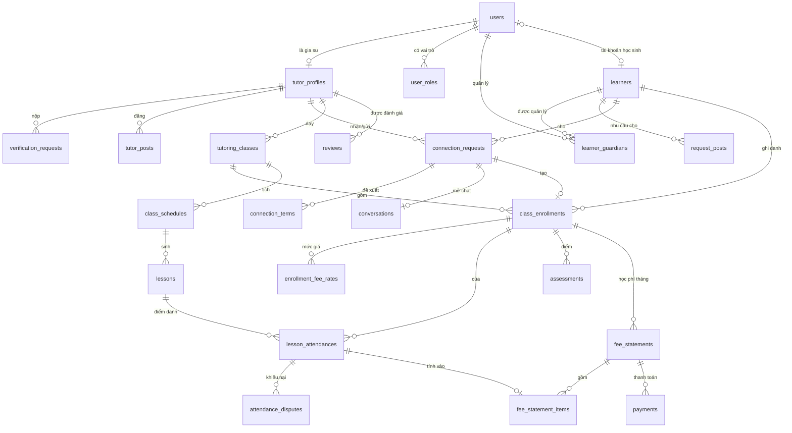

# Thiết kế cơ sở dữ liệu – TPS-Connection

Tài liệu này thiết kế schema PostgreSQL cho toàn bộ hệ thống: bản đầu (MVP) và các bản mở rộng đã có định hướng. Mục tiêu là đúng nghiệp vụ, toàn vẹn dữ liệu nằm ở database chứ không chỉ ở code, và mở rộng được mà không phải đập đi làm lại.

**Căn cứ:** [mô tả nghiệp vụ](mo_ta_nghiep_vu.md), [decision log](00-product/decision-log.md) (mã quyết định ghi trong ngoặc, ví dụ _(D15)_), [công nghệ sử dụng](cong_nghe_su_dung.md), [kế hoạch triển khai](ke_hoach_trien_khai.md).

> Trạng thái: **đã review, các giả định đã được chốt ngày 2026-11-12** (giai đoạn G0). DDL trong tài liệu là đặc tả, chưa phải migration chạy được: các cột `created_at`, `updated_at` được viết tắt là `-- + timestamps` (xem mục 1.3). Migration thật sẽ viết bằng TypeORM theo từng giai đoạn ở mục 14.

---

## 0. Tóm tắt các quyết định thiết kế chính

| # | Quyết định | Lý do |
| - | ---------- | ----- |
| 1 | Hồ sơ người học (`learners`) **tách khỏi** tài khoản (`users`) | Hồ sơ con tồn tại khi trẻ chưa có tài khoản _(D4)_; người học trưởng thành tự quản lý chỉ là trường hợp hồ sơ gắn với chính tài khoản của mình _(D3)_ |
| 2 | Quan hệ phụ huynh–con qua bảng `learner_guardians`, ràng buộc "một phụ huynh đang quản lý" bằng partial unique index | Đáp ứng C9 hôm nay; nếu sau này cho hai phụ huynh thì chỉ cần bỏ index, không đổi cấu trúc. Bảng cũng giữ lịch sử đổi người quản lý |
| 3 | Lớp học (`tutoring_classes`) và ghi danh (`class_enrollments`) tách nhau | MVP chỉ lớp 1-1 nhưng lớp nhóm chỉ là nhiều ghi danh trong một lớp _(D7)_. Mọi dữ liệu theo từng học sinh (điểm danh, học phí, điểm) gắn với ghi danh |
| 4 | Điều khoản hợp tác (`connection_terms`) có phiên bản; xác nhận gắn với một phiên bản cụ thể | Hai bên phải cùng xác nhận đúng một bộ điều kiện _(C3)_; đổi điều kiện thì xác nhận cũ tự mất hiệu lực |
| 5 | Giá học phí được **chụp lại** trên từng bản ghi điểm danh | Đổi học phí chỉ áp dụng cho buổi sau _(D17)_; số liệu cũ không bao giờ bị tính lại |
| 6 | Trạng thái dùng `text` + `CHECK`, không dùng kiểu `ENUM` của PostgreSQL | Thêm hay bỏ giá trị chỉ cần sửa constraint trong migration; `ENUM` không bỏ được giá trị. Danh sách giá trị đồng bộ với `packages/shared` |
| 7 | Không xóa cứng dữ liệu học tập; xóa tài khoản = ẩn danh hóa | Lịch sử học tập phải giữ _(§16.13)_; dữ liệu cá nhân xóa sau 6 tháng _(C2, D19)_ |
| 8 | Tiền lưu `bigint` theo đồng (VND), tên cột kết thúc bằng `_vnd` | Không sai số làm tròn; VND không có đơn vị lẻ |
| 9 | Tệp lưu ở object storage; database chỉ giữ metadata trong bảng `files` | Phân quyền tệp tập trung; xóa ảnh giấy tờ theo lịch _(C4)_ |
| 10 | Quyền truy cập theo quan hệ được kiểm tra ở tầng service bằng các truy vấn chuẩn (mục 12) | Đúng định hướng kiến trúc; có thể bổ sung Row-Level Security của PostgreSQL sau mà không đổi schema |

---

## 1. Quy ước chung

### 1.1. Đặt tên

- Bảng: `snake_case`, số nhiều (`users`, `lessons`). Cột: `snake_case`, số ít.
- Khóa ngoại: `<thực thể>_id` (`tutor_id`, `learner_id`). Cột thời điểm: hậu tố `_at` (`timestamptz`); cột ngày: hậu tố `_on` hoặc `_date` (`date`).
- Entity TypeORM: PascalCase số ít. Tránh từ khóa dễ nhầm: `TutoringClass` (không dùng `Class`), `ViolationReport` (báo cáo vi phạm) khác `LearningReport` (báo cáo học tập), `Assessment` (điểm) khác `Review` (đánh giá gia sư).
- Index: `<bảng>_<cột>_idx`; unique: `<bảng>_<ý nghĩa>_uq`.

### 1.2. Khóa chính

- Bảng nghiệp vụ: `uuid`. Ứng dụng sinh **UUIDv7** (có thứ tự theo thời gian, index B-tree ít phân mảnh hơn UUIDv4, không lộ số lượng bản ghi như số tự tăng). Default `gen_random_uuid()` ở database chỉ để dự phòng. Nếu dùng PostgreSQL 18 thì có sẵn hàm `uuidv7()`.
- Bảng danh mục nhỏ, ổn định (môn học, khối lớp, đơn vị hành chính): `integer GENERATED ALWAYS AS IDENTITY`.
- Bảng log khối lượng lớn, chỉ ghi thêm (`audit_logs`, `connection_events`): `bigint GENERATED ALWAYS AS IDENTITY`.

### 1.3. Cột chung và thời gian

- `-- + timestamps` nghĩa là bảng có:
  ```sql
  created_at timestamptz NOT NULL DEFAULT now(),
  updated_at timestamptz NOT NULL DEFAULT now()
  ```
  `updated_at` do TypeORM (`@UpdateDateColumn`) cập nhật.
- Mọi thời điểm là `timestamptz`, lưu UTC, hiển thị theo `Asia/Ho_Chi_Minh`. Lịch lặp lưu ngày và giờ địa phương kèm múi giờ (mục 7.2), vì "19:00 thứ Ba" là khái niệm theo giờ địa phương.
- Khung giờ trong tuần: `weekday smallint` theo ISO (1 = thứ Hai … 7 = Chủ nhật) + `start_time time`, `end_time time`.

### 1.4. Xóa dữ liệu

- **Xóa mềm** (`deleted_at`) chỉ dùng cho dữ liệu người dùng chủ động xóa: `users`, `learners`, `tutor_posts`, `request_posts`, `messages`, `files`.
- **Không xóa** dữ liệu học tập và tài chính (lớp, buổi học, điểm danh, điểm, học phí, thanh toán, đánh giá). Chúng chỉ đổi trạng thái hoặc được ẩn danh hóa khi tài khoản liên quan bị xóa.
- Khóa ngoại mặc định `ON DELETE RESTRICT`. Chỉ dùng `ON DELETE CASCADE` cho bảng con thuần túy không mang lịch sử (khung giờ, bảng nối môn–khối, tệp đính kèm của tin nhắn).

### 1.5. Trạng thái và kiểu dữ liệu

- Trạng thái: `text NOT NULL` + `CHECK (status IN (...))`. Giá trị viết tiếng Anh, `snake_case`; nhãn tiếng Việt/Anh nằm ở i18n.
- Email: `citext` (so sánh không phân biệt hoa thường).
- Tiền: `bigint` + `CHECK (... >= 0)`. Điểm số: `numeric(6,2)`.
- Đa ngôn ngữ cho danh mục: cột `name_vi`, `name_en` _(C11)_. Nếu sau này cần thêm ngôn ngữ thứ ba, chuyển sang bảng dịch riêng (mục 15).
- `jsonb` chỉ dùng cho dữ liệu ảnh chụp không cần ràng buộc hoặc join (lịch đề xuất trong điều khoản, `metadata` của log, `data` của thông báo).

### 1.6. Extension

```sql
CREATE EXTENSION IF NOT EXISTS citext;    -- email không phân biệt hoa thường
CREATE EXTENSION IF NOT EXISTS unaccent;  -- tìm tiếng Việt không dấu
CREATE EXTENSION IF NOT EXISTS pg_trgm;   -- tìm gần đúng theo tên

-- unaccent() không IMMUTABLE nên không dùng trực tiếp trong index được; bọc lại:
CREATE FUNCTION immutable_unaccent(text) RETURNS text
  LANGUAGE sql IMMUTABLE PARALLEL SAFE STRICT
  AS $$ SELECT public.unaccent('public.unaccent', $1) $$;
```

PostGIS chưa cần ở bản đầu; lọc theo bán kính để sau _(D11)_.

---

## 2. Tổng quan các nhóm bảng

| Nhóm | Bảng | Bản phát hành |
| ---- | ---- | ------------- |
| Danh mục | `subjects`, `grade_levels`, `administrative_areas` | MVP |
| Tài khoản, phân quyền | `users`, `roles`, `user_roles`, `auth_sessions`, `user_consents`, `user_blocks` | MVP |
| Tệp | `files` | MVP |
| Hồ sơ | `tutor_profiles`, `tutor_teaching_subjects`, `tutor_service_areas`, `tutor_availability_slots`, `tutor_credentials`, `parent_profiles`, `learners`, `learner_guardians`, `student_invitations` | MVP |
| Xác minh | `verification_requests`, `verification_documents` | MVP |
| Marketplace | `tutor_posts`, `tutor_post_subjects`, `tutor_post_areas`, `tutor_post_slots`, `request_posts`, `request_post_slots`, `favorite_tutors` | MVP |
| Kết nối | `connection_requests`, `connection_terms`, `connection_events` | MVP |
| Nhắn tin | `conversations`, `conversation_participants`, `messages`, `message_attachments` | MVP |
| Giảng dạy | `tutoring_classes`, `class_enrollments`, `enrollment_fee_rates`, `learning_goals`, `class_schedules`, `lessons`, `lesson_attendances`, `attendance_disputes`, `assessments` | MVP |
| Học phí | `fee_statements`, `fee_statement_items`, `payments` | MVP |
| Kiểm duyệt | `moderation_cases`, `violation_reports`, `account_sanctions`, `audit_logs` | MVP |
| Thông báo | `notifications`, `notification_deliveries`, `notification_preferences`, `device_tokens` | MVP (`device_tokens`: bản 2) |
| Học tập | `assignments`, `assignment_resources`, `assignment_recipients`, `submissions`, `submission_files`, `learning_reports` | Bản 3 |
| Đánh giá | `reviews`, `review_replies` | Bản 3 |

Dữ liệu ngắn hạn **không** nằm trong PostgreSQL: OTP xác thực email, token đặt lại mật khẩu, bộ đếm rate limit, trạng thái online. Các dữ liệu này nằm ở Redis, có TTL.

### 2.1. Sơ đồ quan hệ chính



---

## 3. Danh mục

```sql
CREATE TABLE subjects (
  id          integer GENERATED ALWAYS AS IDENTITY PRIMARY KEY,
  code        text    NOT NULL UNIQUE,              -- 'math', 'english', ...
  parent_id   integer REFERENCES subjects(id),      -- nhóm môn (Tự nhiên, Ngoại ngữ, ...)
  name_vi     text    NOT NULL,
  name_en     text    NOT NULL,
  sort_order  integer NOT NULL DEFAULT 0,
  is_active   boolean NOT NULL DEFAULT true
  -- + timestamps
);

CREATE TABLE grade_levels (
  id          integer GENERATED ALWAYS AS IDENTITY PRIMARY KEY,
  code        text    NOT NULL UNIQUE,              -- 'grade_1' ... 'grade_12', 'university', 'working_adult'
  stage       text    NOT NULL CHECK (stage IN ('preschool','primary','lower_secondary',
                                                'upper_secondary','university','working_adult','other')),
  name_vi     text    NOT NULL,
  name_en     text    NOT NULL,
  sort_order  integer NOT NULL DEFAULT 0,
  is_active   boolean NOT NULL DEFAULT true
  -- + timestamps
);

CREATE TABLE administrative_areas (
  id          integer GENERATED ALWAYS AS IDENTITY PRIMARY KEY,
  code        text    NOT NULL UNIQUE,              -- mã đơn vị hành chính chính thức
  level       text    NOT NULL CHECK (level IN ('province','commune')),
  parent_id   integer REFERENCES administrative_areas(id),
  name        text    NOT NULL,                     -- địa danh không dịch
  name_ascii  text    NOT NULL,                     -- không dấu, để tìm kiếm
  latitude    numeric(9,6),                         -- để dành cho lọc bán kính (D11)
  longitude   numeric(9,6),
  is_active   boolean NOT NULL DEFAULT true,
  valid_from  date,                                 -- hỗ trợ thay đổi địa giới (sắp xếp 2025)
  valid_to    date,
  CHECK ((level = 'province') = (parent_id IS NULL))
  -- + timestamps
);
CREATE INDEX administrative_areas_parent_idx ON administrative_areas (parent_id) WHERE is_active;
```

**Ghi chú:**

- Danh mục hành chính hai cấp tỉnh – xã theo sắp xếp năm 2025. Đơn vị cũ không xóa mà đặt `is_active = false` và `valid_to`, để dữ liệu cũ vẫn tham chiếu được.
- Danh mục chỉ Admin sửa; không xóa bản ghi đã được tham chiếu, chỉ ẩn bằng `is_active`.

---

## 4. Tài khoản, phân quyền và tệp

```sql
CREATE TABLE users (
  id                 uuid PRIMARY KEY DEFAULT gen_random_uuid(),
  email              citext,                         -- NULL sau khi ẩn danh hóa
  email_verified_at  timestamptz,
  password_hash      text,                           -- argon2
  phone              text,                           -- tự khai (C12)
  phone_verified_at  timestamptz,                    -- luôn NULL ở bản đầu; dành cho SMS sau này
  display_name       text NOT NULL,                  -- tên hiển thị công khai
  full_name          text,                           -- họ tên thật, không công khai
  avatar_file_id     uuid,                           -- FK tới files, thêm sau khi tạo bảng files
  locale             text NOT NULL DEFAULT 'vi' CHECK (locale IN ('vi','en')),
  status             text NOT NULL DEFAULT 'active' CHECK (status IN ('active','restricted','locked')),
  last_login_at      timestamptz,
  deleted_at         timestamptz,                    -- người dùng xóa tài khoản: ẩn ngay
  anonymized_at      timestamptz,                    -- job chạy sau 6 tháng (C2)
  CHECK (anonymized_at IS NULL OR deleted_at IS NOT NULL),
  CHECK (email IS NOT NULL OR anonymized_at IS NOT NULL)
  -- + timestamps
);
CREATE UNIQUE INDEX users_email_uq ON users (email) WHERE deleted_at IS NULL;

CREATE TABLE roles (
  code      text PRIMARY KEY,                        -- 'tutor','parent','student','manager','admin'
  name_vi   text NOT NULL,
  name_en   text NOT NULL,
  is_staff  boolean NOT NULL DEFAULT false           -- manager, admin
);

CREATE TABLE user_roles (
  id          uuid PRIMARY KEY DEFAULT gen_random_uuid(),
  user_id     uuid NOT NULL REFERENCES users(id),
  role_code   text NOT NULL REFERENCES roles(code),
  granted_at  timestamptz NOT NULL DEFAULT now(),
  granted_by  uuid REFERENCES users(id),             -- NULL = tự đăng ký
  revoked_at  timestamptz,
  revoked_by  uuid REFERENCES users(id)
);
CREATE UNIQUE INDEX user_roles_active_uq ON user_roles (user_id, role_code) WHERE revoked_at IS NULL;

CREATE TABLE auth_sessions (                         -- refresh token xoay vòng
  id                  uuid PRIMARY KEY DEFAULT gen_random_uuid(),
  user_id             uuid NOT NULL REFERENCES users(id),
  family_id           uuid NOT NULL,                 -- cả chuỗi token cùng một lần đăng nhập
  refresh_token_hash  text NOT NULL UNIQUE,
  user_agent          text,
  ip_address          inet,
  expires_at          timestamptz NOT NULL,
  rotated_at          timestamptz,                   -- đã đổi sang token mới
  revoked_at          timestamptz,
  revoke_reason       text CHECK (revoke_reason IN ('logout','reuse_detected','account_locked',
                                                    'password_changed','admin')),
  created_at          timestamptz NOT NULL DEFAULT now()
);
CREATE INDEX auth_sessions_user_active_idx ON auth_sessions (user_id) WHERE revoked_at IS NULL;
CREATE INDEX auth_sessions_family_idx ON auth_sessions (family_id);

CREATE TABLE user_consents (                         -- bằng chứng đồng ý xử lý dữ liệu
  id            uuid PRIMARY KEY DEFAULT gen_random_uuid(),
  user_id       uuid NOT NULL REFERENCES users(id),
  consent_type  text NOT NULL CHECK (consent_type IN ('terms_of_service','privacy_policy',
                                                      'child_data_processing','marketing_email')),
  version       text NOT NULL,                       -- phiên bản văn bản đã đồng ý
  learner_id    uuid,                                -- FK tới learners khi đồng ý cho dữ liệu của con
  granted_at    timestamptz NOT NULL DEFAULT now(),
  withdrawn_at  timestamptz,
  ip_address    inet
);
CREATE INDEX user_consents_user_idx ON user_consents (user_id, consent_type);

CREATE TABLE user_blocks (
  blocker_id  uuid NOT NULL REFERENCES users(id),
  blocked_id  uuid NOT NULL REFERENCES users(id),
  created_at  timestamptz NOT NULL DEFAULT now(),
  PRIMARY KEY (blocker_id, blocked_id),
  CHECK (blocker_id <> blocked_id)
);
CREATE INDEX user_blocks_blocked_idx ON user_blocks (blocked_id);

CREATE TABLE files (
  id              uuid PRIMARY KEY DEFAULT gen_random_uuid(),
  owner_user_id   uuid NOT NULL REFERENCES users(id),
  bucket          text NOT NULL CHECK (bucket IN ('public','private')),
  storage_key     text NOT NULL UNIQUE,
  purpose         text NOT NULL CHECK (purpose IN ('avatar','verification_document','credential',
                                                   'message_attachment','assignment_resource',
                                                   'submission','post_media','other')),
  original_name   text,
  mime_type       text NOT NULL,
  size_bytes      bigint NOT NULL CHECK (size_bytes > 0),
  checksum_sha256 text,
  status          text NOT NULL DEFAULT 'pending_upload'
                    CHECK (status IN ('pending_upload','ready','deleted')),
  purge_after     timestamptz,                       -- job xóa tệp khỏi storage (giấy tờ: C4)
  deleted_at      timestamptz,
  CHECK (purpose <> 'verification_document' OR bucket = 'private')
  -- + timestamps
);
CREATE INDEX files_purge_idx ON files (purge_after) WHERE purge_after IS NOT NULL AND deleted_at IS NULL;

ALTER TABLE users ADD FOREIGN KEY (avatar_file_id) REFERENCES files(id);
```

**Ghi chú:**

- Một người có thể có nhiều vai trò (ví dụ vừa là gia sư vừa là phụ huynh). Vai trò hiện hành là các dòng `user_roles` có `revoked_at IS NULL`.
- `users.status` phản ánh chế tài đang có hiệu lực (mục 10). Chi tiết lịch sử chế tài nằm ở `account_sanctions`.
- Email được dùng lại để đăng ký mới khi tài khoản cũ đã xóa (partial unique index chỉ áp cho tài khoản chưa xóa).
- `files.status = 'pending_upload'` khi đã cấp presigned URL nhưng client chưa tải xong; job dọn các bản ghi treo quá 24 giờ.

---

## 5. Hồ sơ

### 5.1. Gia sư

```sql
CREATE TABLE tutor_profiles (
  user_id               uuid PRIMARY KEY REFERENCES users(id),   -- quan hệ 1-1 với users
  headline              text,
  bio                   text,
  occupation            text CHECK (occupation IN ('university_student','teacher','professional','other')),
  institution           text,                         -- trường / đơn vị công tác (tự khai)
  major                 text,
  highest_education     text,
  experience_years      smallint CHECK (experience_years BETWEEN 0 AND 80),
  teaching_method       text,
  achievements          text,
  intro_video_url       text,
  teaches_online        boolean NOT NULL DEFAULT false,
  teaches_in_person     boolean NOT NULL DEFAULT false,
  rate_amount_vnd       bigint CHECK (rate_amount_vnd >= 0),   -- học phí tham khảo (D18)
  rate_unit             text   CHECK (rate_unit IN ('hour','session')),
  accepting_students    boolean NOT NULL DEFAULT true,
  profile_status        text NOT NULL DEFAULT 'incomplete'
                          CHECK (profile_status IN ('incomplete','pending_verification','verified')),
  identity_verified_at  timestamptz,
  has_verified_degree   boolean NOT NULL DEFAULT false,  -- phi chuẩn hóa cho bộ lọc (D20)
  rating_avg            numeric(3,2),                    -- phi chuẩn hóa từ reviews (bản 3)
  rating_count          integer NOT NULL DEFAULT 0,
  search_vector         tsvector,                        -- cập nhật khi hồ sơ, môn học thay đổi
  CHECK ((rate_amount_vnd IS NULL) = (rate_unit IS NULL)),
  CHECK (profile_status <> 'verified' OR identity_verified_at IS NOT NULL)
  -- + timestamps
);

CREATE TABLE tutor_teaching_subjects (                -- môn × khối lớp dạy được
  tutor_id        uuid    NOT NULL REFERENCES tutor_profiles(user_id) ON DELETE CASCADE,
  subject_id      integer NOT NULL REFERENCES subjects(id),
  grade_level_id  integer NOT NULL REFERENCES grade_levels(id),
  PRIMARY KEY (tutor_id, subject_id, grade_level_id)
);
CREATE INDEX tutor_teaching_subjects_search_idx
  ON tutor_teaching_subjects (subject_id, grade_level_id, tutor_id);

CREATE TABLE tutor_service_areas (                    -- khu vực dạy trực tiếp
  tutor_id  uuid    NOT NULL REFERENCES tutor_profiles(user_id) ON DELETE CASCADE,
  area_id   integer NOT NULL REFERENCES administrative_areas(id),  -- tỉnh hoặc xã
  PRIMARY KEY (tutor_id, area_id)
);
CREATE INDEX tutor_service_areas_area_idx ON tutor_service_areas (area_id, tutor_id);

CREATE TABLE tutor_availability_slots (               -- lịch rảnh theo tuần
  id          uuid PRIMARY KEY DEFAULT gen_random_uuid(),
  tutor_id    uuid NOT NULL REFERENCES tutor_profiles(user_id) ON DELETE CASCADE,
  weekday     smallint NOT NULL CHECK (weekday BETWEEN 1 AND 7),
  start_time  time NOT NULL,
  end_time    time NOT NULL,
  CHECK (end_time > start_time)
);
CREATE INDEX tutor_availability_slots_idx ON tutor_availability_slots (weekday, start_time, end_time);

CREATE TABLE tutor_credentials (                      -- bằng cấp, chứng chỉ, thẻ sinh viên
  id                   uuid PRIMARY KEY DEFAULT gen_random_uuid(),
  tutor_id             uuid NOT NULL REFERENCES tutor_profiles(user_id),
  kind                 text NOT NULL CHECK (kind IN ('degree','certificate','student_card')),
  title                text NOT NULL,                 -- "Cử nhân Sư phạm Toán", "IELTS 8.0"
  issuer               text,
  issued_year          smallint,
  verification_status  text NOT NULL DEFAULT 'self_declared'
                         CHECK (verification_status IN ('self_declared','pending','verified','rejected')),
  verified_at          timestamptz
  -- + timestamps
);
CREATE INDEX tutor_credentials_tutor_idx ON tutor_credentials (tutor_id);
```

**Tự khai và đã xác minh** _(§3.2, §13)_: các cột văn bản trong `tutor_profiles` là **tự khai**. Thông tin **đã xác minh** gồm danh tính (`identity_verified_at`) và từng bằng cấp, chứng chỉ có `verification_status = 'verified'`. Giao diện dựa vào đó để gắn nhãn.

**Điều kiện hiển thị công khai** _(D5, C8)_: `profile_status = 'verified'` và `users.status = 'active'` và `users.deleted_at IS NULL`.

### 5.2. Phụ huynh và người học

```sql
CREATE TABLE parent_profiles (
  user_id       uuid PRIMARY KEY REFERENCES users(id),
  province_id   integer REFERENCES administrative_areas(id),
  commune_id    integer REFERENCES administrative_areas(id),
  address_line  text                                  -- riêng tư
  -- + timestamps
);

CREATE TABLE learners (                               -- hồ sơ người học, độc lập với tài khoản
  id               uuid PRIMARY KEY DEFAULT gen_random_uuid(),
  account_user_id  uuid UNIQUE REFERENCES users(id),  -- tài khoản học sinh, NULL nếu chưa có
  is_self_managed  boolean NOT NULL DEFAULT false,    -- người học trưởng thành tự quản lý (D3, chưa mở)
  full_name        text,                              -- riêng tư; NULL sau khi ẩn danh
  nickname         text,                              -- tên gọi trong lớp
  date_of_birth    date,                              -- riêng tư; dùng cho ngưỡng tuổi và mốc 18 tuổi
  grade_level_id   integer REFERENCES grade_levels(id),
  school_name      text,                              -- riêng tư
  province_id      integer REFERENCES administrative_areas(id),
  commune_id       integer REFERENCES administrative_areas(id),
  address_line     text,                              -- riêng tư
  notes            text,                              -- ghi chú của phụ huynh cho gia sư
  created_by       uuid NOT NULL REFERENCES users(id),
  deleted_at       timestamptz,
  anonymized_at    timestamptz,
  CHECK (NOT is_self_managed OR account_user_id IS NOT NULL)
  -- + timestamps
);

CREATE TABLE learner_guardians (                      -- phụ huynh quản lý (C9)
  id                uuid PRIMARY KEY DEFAULT gen_random_uuid(),
  learner_id        uuid NOT NULL REFERENCES learners(id),
  guardian_user_id  uuid NOT NULL REFERENCES users(id),
  relationship      text NOT NULL CHECK (relationship IN ('father','mother','guardian','other')),
  started_at        timestamptz NOT NULL DEFAULT now(),
  ended_at          timestamptz,
  ended_reason      text CHECK (ended_reason IN ('transferred','learner_self_managed','account_deleted')),
  changed_by        uuid REFERENCES users(id)          -- Admin khi đổi người quản lý
);
-- C9: mỗi người học chỉ có MỘT phụ huynh đang quản lý.
CREATE UNIQUE INDEX learner_guardians_one_active_uq ON learner_guardians (learner_id) WHERE ended_at IS NULL;
-- "Danh sách con của tôi"
CREATE INDEX learner_guardians_guardian_idx ON learner_guardians (guardian_user_id) WHERE ended_at IS NULL;

CREATE TABLE student_invitations (                    -- phụ huynh mời con tạo tài khoản (D4)
  id           uuid PRIMARY KEY DEFAULT gen_random_uuid(),
  learner_id   uuid NOT NULL REFERENCES learners(id),
  email        citext NOT NULL,
  token_hash   text NOT NULL UNIQUE,
  invited_by   uuid NOT NULL REFERENCES users(id),
  expires_at   timestamptz NOT NULL,
  accepted_at  timestamptz,
  revoked_at   timestamptz,
  created_at   timestamptz NOT NULL DEFAULT now()
);
CREATE UNIQUE INDEX student_invitations_open_uq ON student_invitations (learner_id)
  WHERE accepted_at IS NULL AND revoked_at IS NULL;

ALTER TABLE user_consents ADD FOREIGN KEY (learner_id) REFERENCES learners(id);
```

**Người quản lý của một người học** (dùng ở nhiều chỗ, gọi là **client**): phụ huynh có dòng `learner_guardians` đang hiệu lực; hoặc chính `account_user_id` nếu `is_self_managed = true`. Đóng gói thành một view:

```sql
CREATE VIEW learner_managers AS
  SELECT learner_id, guardian_user_id AS manager_user_id FROM learner_guardians WHERE ended_at IS NULL
  UNION ALL
  SELECT id, account_user_id FROM learners WHERE is_self_managed;
```

**Thông tin riêng tư của trẻ** (`full_name`, `date_of_birth`, `school_name`, `address_line`) không bao giờ xuất hiện trong bài đăng. API chỉ trả các cột này cho gia sư khi có yêu cầu kết nối ở trạng thái `confirmed` _(D16)_. Trước đó gia sư chỉ thấy khối lớp, môn, mục tiêu và tỉnh/xã.

---

## 6. Xác minh, marketplace, kết nối và nhắn tin

### 6.1. Xác minh gia sư

```sql
CREATE TABLE verification_requests (
  id                   uuid PRIMARY KEY DEFAULT gen_random_uuid(),
  tutor_id             uuid NOT NULL REFERENCES tutor_profiles(user_id),
  kind                 text NOT NULL CHECK (kind IN ('identity','credential')),
  credential_id        uuid REFERENCES tutor_credentials(id),
  status               text NOT NULL DEFAULT 'pending'
                         CHECK (status IN ('pending','approved','rejected','cancelled')),
  submitted_at         timestamptz NOT NULL DEFAULT now(),
  review_due_at        timestamptz NOT NULL,          -- submitted + 2 ngày làm việc (C4)
  reviewed_by          uuid REFERENCES users(id),     -- Manager
  reviewed_at          timestamptz,
  rejection_reason     text,
  documents_purge_at   timestamptz,                   -- reviewed_at + 30 ngày nếu approved (C4)
  documents_purged_at  timestamptz,
  CHECK ((kind = 'credential') = (credential_id IS NOT NULL)),
  CHECK (status <> 'rejected' OR rejection_reason IS NOT NULL),
  CHECK ((status IN ('approved','rejected')) = (reviewed_at IS NOT NULL))
  -- + timestamps
);
-- Mỗi gia sư chỉ có một yêu cầu đang chờ cho mỗi loại / mỗi bằng cấp.
CREATE UNIQUE INDEX verification_requests_pending_uq
  ON verification_requests (tutor_id, kind, coalesce(credential_id, '00000000-0000-0000-0000-000000000000'))
  WHERE status = 'pending';
-- Hàng chờ của Manager, sắp theo hạn xử lý.
CREATE INDEX verification_requests_queue_idx ON verification_requests (review_due_at) WHERE status = 'pending';

CREATE TABLE verification_documents (
  id                uuid PRIMARY KEY DEFAULT gen_random_uuid(),
  request_id        uuid NOT NULL REFERENCES verification_requests(id),
  document_type     text NOT NULL CHECK (document_type IN ('national_id_front','national_id_back',
                                                           'student_card','degree','certificate','other')),
  file_id           uuid NOT NULL REFERENCES files(id),
  created_at        timestamptz NOT NULL DEFAULT now()
);
CREATE INDEX verification_documents_request_idx ON verification_documents (request_id);
```

Khi duyệt yêu cầu `identity`, service cập nhật trong **một transaction**: `verification_requests.status`, `tutor_profiles.identity_verified_at`, `profile_status`, và đặt `files.purge_after` cho các giấy tờ. Khi duyệt yêu cầu `credential` có `kind = 'degree'`, đặt lại `has_verified_degree`. Mọi lần Manager mở giấy tờ ghi vào `audit_logs` _(C1)_.

### 6.2. Bài tuyển học sinh của gia sư

```sql
CREATE TABLE tutor_posts (
  id               uuid PRIMARY KEY DEFAULT gen_random_uuid(),
  tutor_id         uuid NOT NULL REFERENCES tutor_profiles(user_id),
  title            text NOT NULL,
  description      text NOT NULL,
  teaches_online   boolean NOT NULL DEFAULT false,
  teaches_in_person boolean NOT NULL DEFAULT false,
  rate_amount_vnd  bigint CHECK (rate_amount_vnd >= 0),
  rate_unit        text   CHECK (rate_unit IN ('hour','session')),
  capacity         smallint CHECK (capacity > 0),      -- số học sinh có thể nhận
  available_from   date,
  status           text NOT NULL DEFAULT 'draft'
                     CHECK (status IN ('draft','open','paused','full','closed')),
  moderation_hidden_at timestamptz,                     -- Manager ẩn do vi phạm
  published_at     timestamptz,
  view_count       integer NOT NULL DEFAULT 0,
  search_vector    tsvector,
  deleted_at       timestamptz,
  CHECK ((rate_amount_vnd IS NULL) = (rate_unit IS NULL))
  -- + timestamps
);
-- Danh sách bài công khai mới nhất.
CREATE INDEX tutor_posts_public_idx ON tutor_posts (published_at DESC)
  WHERE status = 'open' AND deleted_at IS NULL AND moderation_hidden_at IS NULL;
CREATE INDEX tutor_posts_tutor_idx ON tutor_posts (tutor_id, status);
CREATE INDEX tutor_posts_search_idx ON tutor_posts USING gin (search_vector);

CREATE TABLE tutor_post_subjects (
  post_id         uuid    NOT NULL REFERENCES tutor_posts(id) ON DELETE CASCADE,
  subject_id      integer NOT NULL REFERENCES subjects(id),
  grade_level_id  integer NOT NULL REFERENCES grade_levels(id),
  PRIMARY KEY (post_id, subject_id, grade_level_id)
);
CREATE INDEX tutor_post_subjects_search_idx ON tutor_post_subjects (subject_id, grade_level_id, post_id);

CREATE TABLE tutor_post_areas (
  post_id  uuid    NOT NULL REFERENCES tutor_posts(id) ON DELETE CASCADE,
  area_id  integer NOT NULL REFERENCES administrative_areas(id),
  PRIMARY KEY (post_id, area_id)
);
CREATE INDEX tutor_post_areas_area_idx ON tutor_post_areas (area_id, post_id);

CREATE TABLE tutor_post_slots (
  id          uuid PRIMARY KEY DEFAULT gen_random_uuid(),
  post_id     uuid NOT NULL REFERENCES tutor_posts(id) ON DELETE CASCADE,
  weekday     smallint NOT NULL CHECK (weekday BETWEEN 1 AND 7),
  start_time  time NOT NULL,
  end_time    time NOT NULL,
  CHECK (end_time > start_time)
);
```

Chỉ gia sư đã xác minh mới được chuyển bài sang `open` _(D5)_. Ràng buộc này kiểm tra ở service vì phụ thuộc bảng khác; có thể thêm trigger nếu muốn chặn cả ở database.

### 6.3. Bài tìm gia sư của phụ huynh

```sql
CREATE TABLE request_posts (
  id                  uuid PRIMARY KEY DEFAULT gen_random_uuid(),
  author_user_id      uuid    NOT NULL REFERENCES users(id),        -- phụ huynh (client)
  learner_id          uuid    NOT NULL REFERENCES learners(id),
  subject_id          integer NOT NULL REFERENCES subjects(id),
  grade_level_id      integer NOT NULL REFERENCES grade_levels(id),
  goal                text NOT NULL CHECK (goal IN ('reinforce','exam_prep','advanced','other')),
  goal_note           text,
  teaching_mode       text NOT NULL CHECK (teaching_mode IN ('online','in_person','hybrid')),
  province_id         integer REFERENCES administrative_areas(id),  -- chỉ tỉnh/xã, không địa chỉ (§16.7)
  commune_id          integer REFERENCES administrative_areas(id),
  budget_min_vnd      bigint CHECK (budget_min_vnd >= 0),
  budget_max_vnd      bigint CHECK (budget_max_vnd >= 0),
  budget_unit         text CHECK (budget_unit IN ('hour','session','month')),
  desired_start_date  date,
  tutor_requirements  text,
  description         text,
  status              text NOT NULL DEFAULT 'draft'
                        CHECK (status IN ('draft','open','hidden','closed')),
  closed_reason       text CHECK (closed_reason IN ('found_tutor','no_longer_needed','other')),
  moderation_hidden_at timestamptz,
  published_at        timestamptz,
  deleted_at          timestamptz,
  CHECK (budget_min_vnd IS NULL OR budget_max_vnd IS NULL OR budget_min_vnd <= budget_max_vnd),
  CHECK (teaching_mode = 'online' OR province_id IS NOT NULL)
  -- + timestamps
);
-- Gia sư đã xác minh lọc nhu cầu theo môn, khối, khu vực.
CREATE INDEX request_posts_search_idx ON request_posts (subject_id, grade_level_id, province_id, published_at DESC)
  WHERE status = 'open' AND deleted_at IS NULL AND moderation_hidden_at IS NULL;
CREATE INDEX request_posts_author_idx ON request_posts (author_user_id, status);

CREATE TABLE request_post_slots (
  id          uuid PRIMARY KEY DEFAULT gen_random_uuid(),
  post_id     uuid NOT NULL REFERENCES request_posts(id) ON DELETE CASCADE,
  weekday     smallint NOT NULL CHECK (weekday BETWEEN 1 AND 7),
  start_time  time NOT NULL,
  end_time    time NOT NULL,
  CHECK (end_time > start_time)
);

CREATE TABLE favorite_tutors (
  user_id     uuid NOT NULL REFERENCES users(id),
  tutor_id    uuid NOT NULL REFERENCES tutor_profiles(user_id),
  created_at  timestamptz NOT NULL DEFAULT now(),
  PRIMARY KEY (user_id, tutor_id)
);
```

Mỗi bài tìm gia sư một môn: một nhu cầu dẫn tới một lớp. Phụ huynh cần nhiều môn thì đăng nhiều bài.

### 6.4. Yêu cầu kết nối

```sql
CREATE TABLE connection_requests (
  id               uuid PRIMARY KEY DEFAULT gen_random_uuid(),
  direction        text NOT NULL CHECK (direction IN ('client_to_tutor','tutor_to_client')),
  tutor_id         uuid    NOT NULL REFERENCES tutor_profiles(user_id),
  client_user_id   uuid    NOT NULL REFERENCES users(id),   -- phụ huynh (hoặc người học tự quản lý, D3)
  learner_id       uuid    NOT NULL REFERENCES learners(id),
  subject_id       integer NOT NULL REFERENCES subjects(id),
  tutor_post_id    uuid REFERENCES tutor_posts(id),         -- nguồn khi phụ huynh gửi từ bài đăng
  request_post_id  uuid REFERENCES request_posts(id),       -- nguồn khi gia sư ứng tuyển
  message          text,
  status           text NOT NULL DEFAULT 'pending'
                     CHECK (status IN ('pending','negotiating','confirmed','rejected','cancelled')),
  cancel_reason    text CHECK (cancel_reason IN ('withdrawn','ended_by_party','source_closed',
                                                 'expired_pending','expired_negotiating')),
  rejection_note   text,
  accepted_at      timestamptz,                  -- sự kiện chấp nhận (D15)
  confirmed_at     timestamptz,
  closed_at        timestamptz,                  -- rejected / cancelled
  expires_at       timestamptz NOT NULL,         -- pending: +7 ngày; negotiating: accepted_at + 30 ngày (C3)
  expiry_reminded_at timestamptz,
  agreed_terms_id  uuid,                         -- FK tới connection_terms, có khi confirmed
  CHECK (direction <> 'tutor_to_client' OR request_post_id IS NOT NULL),
  CHECK ((status = 'cancelled') = (cancel_reason IS NOT NULL)),
  CHECK (status NOT IN ('negotiating','confirmed') OR accepted_at IS NOT NULL),
  CHECK ((status = 'confirmed') = (agreed_terms_id IS NOT NULL AND confirmed_at IS NOT NULL))
  -- + timestamps
);
-- Không có hai yêu cầu đang mở cho cùng gia sư – người học – môn.
CREATE UNIQUE INDEX connection_requests_open_uq ON connection_requests (tutor_id, learner_id, subject_id)
  WHERE status IN ('pending','negotiating');
-- Hộp yêu cầu của gia sư và của phụ huynh.
CREATE INDEX connection_requests_tutor_idx  ON connection_requests (tutor_id, status, created_at DESC);
CREATE INDEX connection_requests_client_idx ON connection_requests (client_user_id, status, created_at DESC);
-- Job tự hủy và nhắc hết hạn (C3).
CREATE INDEX connection_requests_expiry_idx ON connection_requests (expires_at)
  WHERE status IN ('pending','negotiating');

CREATE TABLE connection_terms (                       -- điều khoản đề xuất, có phiên bản
  id                   uuid PRIMARY KEY DEFAULT gen_random_uuid(),
  request_id           uuid NOT NULL REFERENCES connection_requests(id),
  version              integer NOT NULL CHECK (version > 0),
  proposed_by          uuid NOT NULL REFERENCES users(id),
  subject_id           integer NOT NULL REFERENCES subjects(id),
  grade_level_id       integer NOT NULL REFERENCES grade_levels(id),
  goal                 text,
  teaching_mode        text NOT NULL CHECK (teaching_mode IN ('online','in_person','hybrid')),
  province_id          integer REFERENCES administrative_areas(id),
  commune_id           integer REFERENCES administrative_areas(id),
  session_price_vnd    bigint   NOT NULL CHECK (session_price_vnd >= 0),         -- C6, D18
  session_minutes      smallint NOT NULL CHECK (session_minutes BETWEEN 15 AND 600),
  sessions_per_week    smallint CHECK (sessions_per_week BETWEEN 1 AND 14),
  proposed_schedule    jsonb,                          -- ảnh chụp [{weekday, start_time}]
  start_date           date,
  note                 text,
  tutor_confirmed_at   timestamptz,
  client_confirmed_at  timestamptz,
  created_at           timestamptz NOT NULL DEFAULT now(),
  UNIQUE (request_id, version)
);

ALTER TABLE connection_requests
  ADD FOREIGN KEY (agreed_terms_id) REFERENCES connection_terms(id);

CREATE TABLE connection_events (                      -- lịch sử chuyển trạng thái
  id             bigint GENERATED ALWAYS AS IDENTITY PRIMARY KEY,
  request_id     uuid NOT NULL REFERENCES connection_requests(id),
  event          text NOT NULL CHECK (event IN ('created','accepted','rejected','withdrawn',
                   'terms_proposed','confirmed_by_tutor','confirmed_by_client','confirmed',
                   'cancelled_by_party','expiry_reminded','expired')),
  actor_user_id  uuid REFERENCES users(id),            -- NULL = hệ thống (job)
  from_status    text,
  to_status      text,
  data           jsonb,
  created_at     timestamptz NOT NULL DEFAULT now()
);
CREATE INDEX connection_events_request_idx ON connection_events (request_id, created_at);
```

**Máy trạng thái** _(D15)_:

```
pending ──chấp nhận──► negotiating ──cả hai xác nhận cùng một phiên bản terms──► confirmed
   │                        │
   ├─từ chối─► rejected     └─một bên hủy / quá 30 ngày─► cancelled
   └─bên gửi rút / quá 7 ngày─► cancelled
```

- Bên nhận được xác định bởi `direction`: `client_to_tutor` thì gia sư là bên nhận, ngược lại là phụ huynh.
- Khi có phiên bản `connection_terms` mới, mọi xác nhận trên phiên bản cũ mất hiệu lực. Chỉ phiên bản lớn nhất được xác nhận. Khi phiên bản đó có đủ `tutor_confirmed_at` và `client_confirmed_at`, service trong **một transaction**: chuyển request sang `confirmed`, ghi `agreed_terms_id`, tạo lớp và ghi danh (mục 7.1), ghi `connection_events`.
- Mọi chuyển trạng thái dùng `UPDATE ... WHERE id = $1 AND status = $old` để tránh hai thao tác đồng thời cùng thắng.

### 6.5. Nhắn tin

```sql
CREATE TABLE conversations (
  id                     uuid PRIMARY KEY DEFAULT gen_random_uuid(),
  kind                   text NOT NULL CHECK (kind IN ('connection','class','support')),
  connection_request_id  uuid UNIQUE REFERENCES connection_requests(id),
  class_id               uuid,                         -- FK tới tutoring_classes; dùng khi mở chat lớp nhóm
  last_message_at        timestamptz,
  created_at             timestamptz NOT NULL DEFAULT now(),
  CHECK (kind <> 'connection' OR connection_request_id IS NOT NULL)
);

CREATE TABLE conversation_participants (
  conversation_id       uuid NOT NULL REFERENCES conversations(id),
  user_id               uuid NOT NULL REFERENCES users(id),
  participant_role      text NOT NULL CHECK (participant_role IN ('tutor','client','student','staff')),
  joined_at             timestamptz NOT NULL DEFAULT now(),
  left_at               timestamptz,
  last_read_message_id  uuid,
  muted                 boolean NOT NULL DEFAULT false,
  PRIMARY KEY (conversation_id, user_id)
);
-- Danh sách hội thoại của tôi.
CREATE INDEX conversation_participants_user_idx ON conversation_participants (user_id) WHERE left_at IS NULL;

CREATE TABLE messages (
  id               uuid PRIMARY KEY,                    -- UUIDv7: sắp theo thời gian
  conversation_id  uuid NOT NULL REFERENCES conversations(id),
  sender_id        uuid REFERENCES users(id),           -- NULL = tin hệ thống
  kind             text NOT NULL DEFAULT 'text' CHECK (kind IN ('text','attachment','system')),
  body             text,
  edited_at        timestamptz,
  deleted_at       timestamptz,
  created_at       timestamptz NOT NULL DEFAULT now(),
  CHECK (kind <> 'text' OR body IS NOT NULL)
);
-- Tải tin theo trang (keyset pagination).
CREATE INDEX messages_conversation_idx ON messages (conversation_id, id DESC);

CREATE TABLE message_attachments (
  message_id  uuid NOT NULL REFERENCES messages(id) ON DELETE CASCADE,
  file_id     uuid NOT NULL REFERENCES files(id),
  PRIMARY KEY (message_id, file_id)
);
```

- Hội thoại `connection` được tạo khi bên nhận chấp nhận yêu cầu _(D14)_. Bản đầu chỉ có hai người tham gia: gia sư (`tutor`) và phụ huynh (`client`) _(C7)_.
- Khi mở cho học sinh (sau MVP), chỉ cần thêm dòng `participant_role = 'student'` cùng phụ huynh trong hội thoại; không đổi cấu trúc.
- Trước khi gửi tin, service kiểm tra `user_blocks` theo cả hai chiều.
- Manager chỉ xem tin nhắn nằm trong báo cáo (`violation_reports.message_id`) và các tin lân cận được cấu hình, không xem toàn bộ hội thoại _(C1)_.

---

## 7. Giảng dạy

### 7.1. Lớp học và ghi danh

```sql
CREATE TABLE tutoring_classes (
  id                       uuid PRIMARY KEY DEFAULT gen_random_uuid(),
  tutor_id                 uuid    NOT NULL REFERENCES tutor_profiles(user_id),
  name                     text    NOT NULL,
  subject_id               integer NOT NULL REFERENCES subjects(id),
  grade_level_id           integer REFERENCES grade_levels(id),
  teaching_mode            text NOT NULL CHECK (teaching_mode IN ('online','in_person','hybrid')),
  class_type               text NOT NULL DEFAULT 'one_on_one' CHECK (class_type IN ('one_on_one','group')),
  capacity                 smallint NOT NULL DEFAULT 1 CHECK (capacity > 0),
  status                   text NOT NULL DEFAULT 'active' CHECK (status IN ('active','paused','ended')),
  started_on               date NOT NULL,
  ended_on                 date,
  ended_reason             text,
  timezone                 text NOT NULL DEFAULT 'Asia/Ho_Chi_Minh',
  created_from_request_id  uuid REFERENCES connection_requests(id),   -- D9
  CHECK (class_type <> 'one_on_one' OR capacity = 1),
  CHECK ((status = 'ended') = (ended_on IS NOT NULL))
  -- + timestamps
);
CREATE INDEX tutoring_classes_tutor_idx ON tutoring_classes (tutor_id, status);

ALTER TABLE conversations ADD FOREIGN KEY (class_id) REFERENCES tutoring_classes(id);

CREATE TABLE class_enrollments (                      -- học sinh trong lớp
  id                     uuid PRIMARY KEY DEFAULT gen_random_uuid(),
  class_id               uuid NOT NULL REFERENCES tutoring_classes(id),
  learner_id             uuid NOT NULL REFERENCES learners(id),
  client_user_id         uuid NOT NULL REFERENCES users(id),  -- người trả học phí tại thời điểm ghi danh
  connection_request_id  uuid UNIQUE REFERENCES connection_requests(id),
  status                 text NOT NULL DEFAULT 'active' CHECK (status IN ('active','paused','left')),
  joined_on              date NOT NULL,
  left_on                date,
  initial_assessment     text,                       -- năng lực ban đầu (gia sư ghi)
  teaching_notes         text,                       -- lưu ý giảng dạy (chỉ gia sư xem)
  CHECK ((status = 'left') = (left_on IS NOT NULL))
  -- + timestamps
);
CREATE UNIQUE INDEX class_enrollments_active_uq ON class_enrollments (class_id, learner_id) WHERE status <> 'left';
-- Lớp của một học sinh (phụ huynh, học sinh xem).
CREATE INDEX class_enrollments_learner_idx ON class_enrollments (learner_id);

CREATE TABLE enrollment_fee_rates (                   -- lịch sử mức học phí (D17)
  id                 uuid PRIMARY KEY DEFAULT gen_random_uuid(),
  enrollment_id      uuid NOT NULL REFERENCES class_enrollments(id),
  session_price_vnd  bigint   NOT NULL CHECK (session_price_vnd >= 0),
  session_minutes    smallint NOT NULL CHECK (session_minutes BETWEEN 15 AND 600),
  status             text NOT NULL CHECK (status IN ('proposed','active','rejected','superseded','withdrawn')),
  effective_from     timestamptz,                    -- buổi bắt đầu từ thời điểm này dùng mức giá này
  proposed_by        uuid NOT NULL REFERENCES users(id),
  decided_by         uuid REFERENCES users(id),      -- phụ huynh đồng ý / từ chối
  decided_at         timestamptz,
  source_terms_id    uuid REFERENCES connection_terms(id),  -- mức giá đầu tiên lấy từ điều khoản
  created_at         timestamptz NOT NULL DEFAULT now(),
  CHECK (status <> 'active' OR effective_from IS NOT NULL)
);
CREATE UNIQUE INDEX enrollment_fee_rates_active_uq ON enrollment_fee_rates (enrollment_id) WHERE status = 'active';
CREATE UNIQUE INDEX enrollment_fee_rates_proposed_uq ON enrollment_fee_rates (enrollment_id) WHERE status = 'proposed';

CREATE TABLE learning_goals (                         -- mục tiêu theo tháng / học kỳ
  id             uuid PRIMARY KEY DEFAULT gen_random_uuid(),
  enrollment_id  uuid NOT NULL REFERENCES class_enrollments(id),
  period_type    text NOT NULL CHECK (period_type IN ('month','term','custom')),
  period_start   date NOT NULL,
  period_end     date NOT NULL,
  description    text NOT NULL,
  status         text NOT NULL DEFAULT 'active'
                   CHECK (status IN ('active','achieved','partially_achieved','not_achieved')),
  progress_note  text,
  CHECK (period_end >= period_start)
  -- + timestamps
);
CREATE INDEX learning_goals_enrollment_idx ON learning_goals (enrollment_id, period_start DESC);
```

- Học phí gắn với **ghi danh**, không gắn với lớp: khi mở lớp nhóm, mỗi học sinh có thể có mức giá riêng.
- Đổi học phí: gia sư tạo dòng `proposed`; phụ huynh đồng ý thì trong một transaction dòng `active` cũ thành `superseded` và dòng mới thành `active` với `effective_from = now()` _(D17)_.
- Gia sư thấy học sinh qua `class_enrollments` của lớp mình, kể cả khi lớp đã kết thúc (để tra cứu lịch sử).

### 7.2. Lịch học và buổi học

```sql
CREATE TABLE class_schedules (                        -- quy tắc lịch
  id                uuid PRIMARY KEY DEFAULT gen_random_uuid(),
  class_id          uuid NOT NULL REFERENCES tutoring_classes(id),
  kind              text NOT NULL CHECK (kind IN ('one_off','weekly')),
  rrule             text,                             -- RFC 5545, ví dụ 'FREQ=WEEKLY;BYDAY=TU,TH'
  start_date        date NOT NULL,                    -- ngày địa phương
  until_date        date,
  local_start_time  time NOT NULL,                    -- giờ địa phương
  duration_minutes  smallint NOT NULL CHECK (duration_minutes BETWEEN 15 AND 600),
  timezone          text NOT NULL DEFAULT 'Asia/Ho_Chi_Minh',
  teaching_mode     text NOT NULL CHECK (teaching_mode IN ('online','in_person')),
  location_note     text,
  online_url        text,
  generated_until   date,                             -- job đã sinh buổi học tới ngày này
  status            text NOT NULL DEFAULT 'active' CHECK (status IN ('active','ended')),
  created_by        uuid NOT NULL REFERENCES users(id),
  CHECK ((kind = 'weekly') = (rrule IS NOT NULL)),
  CHECK (until_date IS NULL OR until_date >= start_date)
  -- + timestamps
);
CREATE INDEX class_schedules_class_idx ON class_schedules (class_id) WHERE status = 'active';

CREATE TABLE lessons (                                -- buổi học cụ thể
  id                    uuid PRIMARY KEY DEFAULT gen_random_uuid(),
  class_id              uuid NOT NULL REFERENCES tutoring_classes(id),
  tutor_id              uuid NOT NULL REFERENCES tutor_profiles(user_id),  -- phi chuẩn hóa cho lịch gia sư
  schedule_id           uuid REFERENCES class_schedules(id),
  occurrence_start      timestamptz,                  -- thời điểm gốc theo RRULE; khóa chống sinh trùng
  starts_at             timestamptz NOT NULL,         -- có thể khác occurrence_start nếu dời buổi
  ends_at               timestamptz NOT NULL,
  teaching_mode         text NOT NULL CHECK (teaching_mode IN ('online','in_person')),
  location_note         text,
  online_url            text,
  status                text NOT NULL DEFAULT 'scheduled'
                          CHECK (status IN ('scheduled','held','cancelled','tutor_absent')),
  makeup_for_lesson_id  uuid REFERENCES lessons(id),  -- buổi học bù
  cancelled_by          uuid REFERENCES users(id),
  cancelled_at          timestamptz,
  cancel_reason         text,
  is_late_cancellation  boolean NOT NULL DEFAULT false,  -- báo hủy dưới 2 giờ (C5)
  content_taught        text,
  tutor_notes           text,
  actual_minutes        smallint CHECK (actual_minutes BETWEEN 0 AND 600),
  recorded_at           timestamptz,                  -- lúc gia sư điểm danh
  recorded_by           uuid REFERENCES users(id),
  CHECK (ends_at > starts_at),
  CHECK ((status = 'cancelled') = (cancelled_at IS NOT NULL)),
  CHECK (makeup_for_lesson_id IS NULL OR makeup_for_lesson_id <> id)
  -- + timestamps
);
CREATE UNIQUE INDEX lessons_occurrence_uq ON lessons (schedule_id, occurrence_start) WHERE schedule_id IS NOT NULL;
-- Lịch theo ngày/tuần/tháng của gia sư.
CREATE INDEX lessons_tutor_time_idx ON lessons (tutor_id, starts_at);
-- Lịch của lớp (phụ huynh, học sinh xem qua ghi danh).
CREATE INDEX lessons_class_time_idx ON lessons (class_id, starts_at);
-- Job nhắc buổi học sắp diễn ra.
CREATE INDEX lessons_upcoming_idx ON lessons (starts_at) WHERE status = 'scheduled';
```

**Sinh buổi học:** job chạy hằng ngày, đọc `class_schedules` đang hoạt động, sinh các buổi trong khoảng N tuần tới (đề xuất 8 tuần) và cập nhật `generated_until`. Index `lessons_occurrence_uq` bảo đảm chạy lại job không tạo trùng. Sửa hay hủy một buổi chỉ đổi dòng `lessons` đó; sửa quy tắc lịch chỉ xóa và sinh lại các buổi **tương lai còn `scheduled`**, không chạm buổi đã qua.

`tutor_id` trên `lessons` là phi chuẩn hóa có chủ đích: truy vấn lịch của gia sư là truy vấn đọc nhiều nhất, và lớp không bao giờ đổi gia sư.

### 7.3. Điểm danh, xác nhận và khiếu nại

```sql
CREATE TABLE lesson_attendances (                     -- mỗi học sinh mỗi buổi một dòng
  id                    uuid PRIMARY KEY DEFAULT gen_random_uuid(),
  lesson_id             uuid NOT NULL REFERENCES lessons(id),
  enrollment_id         uuid NOT NULL REFERENCES class_enrollments(id),
  status                text NOT NULL CHECK (status IN ('present','absent_notified','absent_no_show',
                                                        'not_applicable')),  -- not_applicable: buổi hủy / gia sư vắng
  tutor_comment         text,                         -- nhận xét ngắn cho học sinh trong buổi
  -- Ảnh chụp học phí tại thời điểm buổi học (D17):
  fee_rate_id           uuid REFERENCES enrollment_fee_rates(id),
  session_price_vnd     bigint   NOT NULL CHECK (session_price_vnd >= 0),
  session_minutes       smallint NOT NULL,
  is_billable           boolean  NOT NULL DEFAULT false,
  billable_amount_vnd   bigint   NOT NULL DEFAULT 0 CHECK (billable_amount_vnd >= 0),
  -- Xác nhận của phụ huynh (C5):
  confirmation_status   text NOT NULL DEFAULT 'pending'
                          CHECK (confirmation_status IN ('pending','confirmed','auto_confirmed',
                                                         'disputed','resolved')),
  confirm_due_at        timestamptz NOT NULL,         -- recorded_at + 48 giờ
  confirm_reminded_at   timestamptz,
  confirmed_at          timestamptz,
  confirmed_by          uuid REFERENCES users(id),    -- NULL khi auto_confirmed
  UNIQUE (lesson_id, enrollment_id),
  CHECK (is_billable OR billable_amount_vnd = 0)
  -- + timestamps
);
-- Job nhắc và tự chốt sau 48 giờ.
CREATE INDEX lesson_attendances_due_idx ON lesson_attendances (confirm_due_at) WHERE confirmation_status = 'pending';
-- Lịch sử điểm danh của một học sinh; tổng hợp học phí theo tháng.
CREATE INDEX lesson_attendances_enrollment_idx ON lesson_attendances (enrollment_id, created_at);

CREATE TABLE attendance_disputes (
  id               uuid PRIMARY KEY DEFAULT gen_random_uuid(),
  attendance_id    uuid NOT NULL REFERENCES lesson_attendances(id),
  opened_by        uuid NOT NULL REFERENCES users(id),
  reason           text NOT NULL,
  claimed_status   text CHECK (claimed_status IN ('present','absent_notified','absent_no_show','not_applicable')),
  status           text NOT NULL DEFAULT 'open'
                     CHECK (status IN ('open','settled_by_parties','escalated','resolved_by_manager','withdrawn')),
  negotiate_until  timestamptz NOT NULL,              -- opened + 3 ngày (C5)
  case_id          uuid,                              -- FK tới moderation_cases khi escalated
  resolution_note  text,
  resolved_by      uuid REFERENCES users(id),
  resolved_at      timestamptz
  -- + timestamps
);
CREATE UNIQUE INDEX attendance_disputes_active_uq ON attendance_disputes (attendance_id)
  WHERE status IN ('open','escalated');
CREATE INDEX attendance_disputes_deadline_idx ON attendance_disputes (negotiate_until) WHERE status = 'open';
```

**Quy tắc tính tiền ở bản đầu** _(C5)_: `is_billable = true` khi và chỉ khi `lessons.status = 'held'` và `lesson_attendances.status = 'present'`. Mọi trường hợp vắng hay hủy đều không tính tiền, nhưng `absent_no_show` và `lessons.is_late_cancellation` vẫn được ghi để xem lại sau pilot. Quy tắc nằm ở service để đổi chính sách không cần đổi schema.

**Một buổi được đưa vào học phí** khi `confirmation_status IN ('confirmed','auto_confirmed','resolved')`. Buổi `disputed` chưa tính cho tới khi khiếu nại kết thúc; nếu kết thúc sau khi đã chốt tháng thì được tính vào bảng học phí tháng kế tiếp (mục 8).

### 7.4. Điểm và nhận xét

```sql
CREATE TABLE assessments (
  id             uuid PRIMARY KEY DEFAULT gen_random_uuid(),
  enrollment_id  uuid NOT NULL REFERENCES class_enrollments(id),
  lesson_id      uuid REFERENCES lessons(id),
  submission_id  uuid,                                -- FK tới submissions (bản 3)
  kind           text NOT NULL CHECK (kind IN ('lesson','quiz','test','assignment')),
  title          text NOT NULL,
  score          numeric(6,2),
  max_score      numeric(6,2) NOT NULL DEFAULT 10 CHECK (max_score > 0),
  comment        text,                                -- điểm luôn đi kèm nhận xét (§9)
  assessed_on    date NOT NULL,
  created_by     uuid NOT NULL REFERENCES users(id),
  CHECK (score IS NULL OR score BETWEEN 0 AND max_score)
  -- + timestamps
);
-- Biểu đồ điểm theo thời gian của một học sinh.
CREATE INDEX assessments_enrollment_idx ON assessments (enrollment_id, assessed_on);
```

Không có bảng hay view xếp hạng giữa các học sinh _(§9)_.

---

## 8. Học phí

```sql
CREATE TABLE fee_statements (                         -- bảng học phí tháng của một ghi danh
  id               uuid PRIMARY KEY DEFAULT gen_random_uuid(),
  enrollment_id    uuid NOT NULL REFERENCES class_enrollments(id),
  tutor_id         uuid NOT NULL REFERENCES tutor_profiles(user_id),
  client_user_id   uuid NOT NULL REFERENCES users(id),
  period_month     date NOT NULL CHECK (extract(day FROM period_month) = 1),  -- ngày đầu tháng
  billable_sessions integer NOT NULL DEFAULT 0 CHECK (billable_sessions >= 0),
  total_amount_vnd bigint  NOT NULL DEFAULT 0 CHECK (total_amount_vnd >= 0),
  paid_amount_vnd  bigint  NOT NULL DEFAULT 0 CHECK (paid_amount_vnd >= 0),
  status           text NOT NULL DEFAULT 'issued'      -- 'draft' dành cho sau, bản đầu phát hành ngay
                     CHECK (status IN ('draft','issued','partially_paid','paid','void')),
  issued_at        timestamptz,
  due_date         date,                           -- ngày 5 của tháng kế tiếp (D24)
  UNIQUE (enrollment_id, period_month)
  -- + timestamps
);
CREATE INDEX fee_statements_client_idx ON fee_statements (client_user_id, period_month DESC);
CREATE INDEX fee_statements_tutor_idx  ON fee_statements (tutor_id, period_month DESC);
-- Job nhắc học phí đến hạn.
CREATE INDEX fee_statements_due_idx ON fee_statements (due_date) WHERE status IN ('issued','partially_paid');

CREATE TABLE fee_statement_items (
  id             uuid PRIMARY KEY DEFAULT gen_random_uuid(),
  statement_id   uuid NOT NULL REFERENCES fee_statements(id),
  attendance_id  uuid UNIQUE REFERENCES lesson_attendances(id),  -- mỗi buổi chỉ tính một lần
  item_type      text NOT NULL CHECK (item_type IN ('session','adjustment')),
  description    text,
  amount_vnd     bigint NOT NULL,                     -- adjustment có thể âm
  created_at     timestamptz NOT NULL DEFAULT now(),
  CHECK ((item_type = 'session') = (attendance_id IS NOT NULL)),
  CHECK (item_type <> 'session' OR amount_vnd >= 0)
);
CREATE INDEX fee_statement_items_statement_idx ON fee_statement_items (statement_id);

CREATE TABLE payments (                               -- ghi nhận thanh toán (D6)
  id                 uuid PRIMARY KEY DEFAULT gen_random_uuid(),
  statement_id       uuid NOT NULL REFERENCES fee_statements(id),
  amount_vnd         bigint NOT NULL CHECK (amount_vnd > 0),
  method             text NOT NULL CHECK (method IN ('cash','bank_transfer','e_wallet','online_gateway','other')),
  channel            text NOT NULL DEFAULT 'manual' CHECK (channel IN ('manual','online')),
  paid_on            date NOT NULL,
  reference          text,                            -- mã chuyển khoản, ghi chú
  recorded_by        uuid NOT NULL REFERENCES users(id),
  acknowledged_by    uuid REFERENCES users(id),       -- bên kia xác nhận đã nhận/đã trả
  acknowledged_at    timestamptz,
  status             text NOT NULL DEFAULT 'recorded' CHECK (status IN ('recorded','acknowledged','voided')),
  voided_reason      text,
  gateway_transaction_id text UNIQUE,                 -- để dành cho thanh toán trực tuyến
  CHECK (channel = 'online' OR gateway_transaction_id IS NULL)
  -- + timestamps
);
CREATE INDEX payments_statement_idx ON payments (statement_id);
```

- Đầu tháng, job tạo `fee_statements` cho tháng trước của mỗi ghi danh và thêm `fee_statement_items` cho các buổi đủ điều kiện mà **chưa có** trong bảng nào (`attendance_id` unique). Nhờ vậy buổi khiếu nại kết thúc muộn tự rơi vào tháng sau, không bao giờ tính hai lần.
- `total_amount_vnd` và `paid_amount_vnd` là phi chuẩn hóa để hiển thị nhanh; service cập nhật trong cùng transaction với các dòng con. `paid_amount_vnd` chỉ cộng các thanh toán `acknowledged` (bên kia đã xác nhận).
- Vòng đời chi tiết của mọi trạng thái: xem [thuật ngữ và sơ đồ trạng thái](thuat_ngu_va_trang_thai.md).
- Thanh toán trực tuyến sau này: thêm bảng giao dịch với cổng thanh toán, liên kết qua `gateway_transaction_id`; không đổi cấu trúc hiện có.

---

## 9. Thông báo

```sql
CREATE TABLE notifications (
  id          uuid PRIMARY KEY,                       -- UUIDv7
  user_id     uuid NOT NULL REFERENCES users(id),
  type        text NOT NULL,                          -- 'connection.received', 'lesson.reminder', ... (danh sách ở shared)
  data        jsonb NOT NULL DEFAULT '{}',            -- id thực thể để client dựng nội dung; không chứa thông tin của trẻ
  read_at     timestamptz,
  created_at  timestamptz NOT NULL DEFAULT now()
);
CREATE INDEX notifications_user_idx ON notifications (user_id, id DESC);
CREATE INDEX notifications_unread_idx ON notifications (user_id) WHERE read_at IS NULL;

CREATE TABLE notification_deliveries (
  id               uuid PRIMARY KEY DEFAULT gen_random_uuid(),
  notification_id  uuid NOT NULL REFERENCES notifications(id),
  channel          text NOT NULL CHECK (channel IN ('email','push')),
  status           text NOT NULL DEFAULT 'queued' CHECK (status IN ('queued','sent','failed','skipped')),
  attempts         smallint NOT NULL DEFAULT 0,
  last_error       text,
  sent_at          timestamptz,
  created_at       timestamptz NOT NULL DEFAULT now()
);
CREATE INDEX notification_deliveries_notification_idx ON notification_deliveries (notification_id);

CREATE TABLE notification_preferences (
  user_id  uuid NOT NULL REFERENCES users(id),
  type     text NOT NULL,
  channel  text NOT NULL CHECK (channel IN ('in_app','email','push')),
  enabled  boolean NOT NULL,
  PRIMARY KEY (user_id, type, channel)
);

CREATE TABLE device_tokens (                          -- bản 2 (Mobile)
  id            uuid PRIMARY KEY DEFAULT gen_random_uuid(),
  user_id       uuid NOT NULL REFERENCES users(id),
  platform      text NOT NULL CHECK (platform IN ('ios','android')),
  token         text NOT NULL UNIQUE,
  last_seen_at  timestamptz NOT NULL DEFAULT now(),
  revoked_at    timestamptz,
  created_at    timestamptz NOT NULL DEFAULT now()
);
CREATE INDEX device_tokens_user_idx ON device_tokens (user_id) WHERE revoked_at IS NULL;
```

`notification_preferences` chỉ lưu những lựa chọn khác mặc định; mặc định của từng loại nằm trong code. Bảng `notifications` tăng nhanh nhất; khi lớn có thể partition theo tháng hoặc xóa thông báo đã đọc quá 12 tháng.

---

## 10. Kiểm duyệt và nhật ký

```sql
CREATE TABLE moderation_cases (
  id              uuid PRIMARY KEY DEFAULT gen_random_uuid(),
  case_type       text NOT NULL CHECK (case_type IN ('violation','session_dispute','appeal')),
  status          text NOT NULL DEFAULT 'open' CHECK (status IN ('open','in_review','resolved','dismissed')),
  assigned_to     uuid REFERENCES users(id),
  parent_case_id  uuid REFERENCES moderation_cases(id),   -- appeal trỏ về vụ gốc
  decision        text CHECK (decision IN ('no_action','warning','content_hidden','account_restricted',
                                           'account_locked','record_corrected')),
  decision_note   text,
  decided_by      uuid REFERENCES users(id),
  decided_at      timestamptz,
  CHECK ((case_type = 'appeal') = (parent_case_id IS NOT NULL))
  -- + timestamps
);
CREATE INDEX moderation_cases_queue_idx ON moderation_cases (case_type, status, created_at)
  WHERE status IN ('open','in_review');

ALTER TABLE attendance_disputes ADD FOREIGN KEY (case_id) REFERENCES moderation_cases(id);

CREATE TABLE violation_reports (
  id               uuid PRIMARY KEY DEFAULT gen_random_uuid(),
  reporter_id      uuid NOT NULL REFERENCES users(id),
  -- Đúng MỘT đối tượng bị báo cáo; khóa ngoại thật để giữ toàn vẹn:
  reported_user_id uuid REFERENCES users(id),
  tutor_post_id    uuid REFERENCES tutor_posts(id),
  request_post_id  uuid REFERENCES request_posts(id),
  message_id       uuid REFERENCES messages(id),
  review_id        uuid,                               -- FK tới reviews (bản 3)
  reason_code      text NOT NULL CHECK (reason_code IN ('spam','harassment','inappropriate_content',
                     'fake_profile','child_safety','fraud','other')),
  description      text,
  status           text NOT NULL DEFAULT 'open' CHECK (status IN ('open','linked','closed')),
  case_id          uuid REFERENCES moderation_cases(id),
  created_at       timestamptz NOT NULL DEFAULT now(),
  CHECK (num_nonnulls(reported_user_id, tutor_post_id, request_post_id, message_id, review_id) = 1)
);
CREATE INDEX violation_reports_open_idx ON violation_reports (created_at) WHERE status = 'open';

CREATE TABLE account_sanctions (
  id          uuid PRIMARY KEY DEFAULT gen_random_uuid(),
  user_id     uuid NOT NULL REFERENCES users(id),
  type        text NOT NULL CHECK (type IN ('warning','restriction','lock')),
  reason      text NOT NULL,
  case_id     uuid REFERENCES moderation_cases(id),
  starts_at   timestamptz NOT NULL DEFAULT now(),
  ends_at     timestamptz,                             -- NULL = vô thời hạn
  lifted_at   timestamptz,
  lifted_by   uuid REFERENCES users(id),
  created_by  uuid NOT NULL REFERENCES users(id),
  created_at  timestamptz NOT NULL DEFAULT now()
);
CREATE INDEX account_sanctions_user_idx ON account_sanctions (user_id) WHERE lifted_at IS NULL;

CREATE TABLE audit_logs (                              -- chỉ ghi thêm, không sửa
  id             bigint GENERATED ALWAYS AS IDENTITY PRIMARY KEY,
  actor_user_id  uuid REFERENCES users(id),
  actor_role     text,                                 -- 'manager','admin','system',...
  action         text NOT NULL,                        -- 'verification.document_viewed', 'user.locked', ...
  entity_type    text NOT NULL,
  entity_id      text NOT NULL,
  metadata       jsonb,
  ip_address     inet,
  created_at     timestamptz NOT NULL DEFAULT now()
);
CREATE INDEX audit_logs_entity_idx ON audit_logs (entity_type, entity_id, created_at DESC);
CREATE INDEX audit_logs_actor_idx  ON audit_logs (actor_user_id, created_at DESC);
```

- `violation_reports` dùng nhiều cột khóa ngoại có thể NULL thay vì cặp `(target_type, target_id)` để database tự bảo đảm đối tượng tồn tại. Thêm loại đối tượng mới chỉ cần thêm một cột NULL được, thao tác nhanh.
- `audit_logs` thì ngược lại dùng `entity_type` + `entity_id` vì phải ghi được mọi loại thực thể và không bao giờ join ngược. User ứng dụng chỉ có quyền `INSERT` và `SELECT` trên bảng này.

---

## 11. Bản 3: học tập và đánh giá

```sql
CREATE TABLE assignments (
  id              uuid PRIMARY KEY DEFAULT gen_random_uuid(),
  class_id        uuid NOT NULL REFERENCES tutoring_classes(id),
  created_by      uuid NOT NULL REFERENCES users(id),
  title           text NOT NULL,
  instructions    text,
  due_at          timestamptz,
  allow_resubmit  boolean NOT NULL DEFAULT true,
  status          text NOT NULL DEFAULT 'draft' CHECK (status IN ('draft','published','closed'))
  -- + timestamps
);
CREATE INDEX assignments_class_idx ON assignments (class_id, due_at);

CREATE TABLE assignment_resources (                   -- tệp đính kèm hoặc đường dẫn
  id             uuid PRIMARY KEY DEFAULT gen_random_uuid(),
  assignment_id  uuid NOT NULL REFERENCES assignments(id) ON DELETE CASCADE,
  file_id        uuid REFERENCES files(id),
  url            text,
  label          text,
  CHECK (num_nonnulls(file_id, url) = 1)
);

CREATE TABLE assignment_recipients (                  -- giao cho một hoặc nhiều học sinh
  assignment_id  uuid NOT NULL REFERENCES assignments(id),
  enrollment_id  uuid NOT NULL REFERENCES class_enrollments(id),
  status         text NOT NULL DEFAULT 'assigned'
                   CHECK (status IN ('assigned','submitted','overdue','graded','redo_requested')),
  PRIMARY KEY (assignment_id, enrollment_id)
);
CREATE INDEX assignment_recipients_enrollment_idx ON assignment_recipients (enrollment_id, status);

CREATE TABLE submissions (
  id             uuid PRIMARY KEY DEFAULT gen_random_uuid(),
  assignment_id  uuid NOT NULL,
  enrollment_id  uuid NOT NULL,
  attempt        smallint NOT NULL DEFAULT 1 CHECK (attempt > 0),
  body           text,
  submitted_by   uuid NOT NULL REFERENCES users(id),
  submitted_at   timestamptz NOT NULL DEFAULT now(),
  is_late        boolean NOT NULL DEFAULT false,
  graded_by      uuid REFERENCES users(id),
  graded_at      timestamptz,
  feedback       text,
  FOREIGN KEY (assignment_id, enrollment_id) REFERENCES assignment_recipients (assignment_id, enrollment_id),
  UNIQUE (assignment_id, enrollment_id, attempt)
);

CREATE TABLE submission_files (
  submission_id  uuid NOT NULL REFERENCES submissions(id) ON DELETE CASCADE,
  file_id        uuid NOT NULL REFERENCES files(id),
  PRIMARY KEY (submission_id, file_id)
);

ALTER TABLE assessments ADD FOREIGN KEY (submission_id) REFERENCES submissions(id);

CREATE TABLE learning_reports (                       -- báo cáo tiến độ
  id              uuid PRIMARY KEY DEFAULT gen_random_uuid(),
  enrollment_id   uuid NOT NULL REFERENCES class_enrollments(id),
  author_id       uuid NOT NULL REFERENCES users(id),
  period_type     text NOT NULL CHECK (period_type IN ('lesson','week','month','course_end')),
  period_start    date NOT NULL,
  period_end      date NOT NULL,
  topics_covered  text,
  strengths       text,
  improvements    text,
  goal_progress   text,
  recommendations text,
  overall_comment text,
  metrics         jsonb,                              -- ảnh chụp số liệu lúc gửi: số buổi, tỷ lệ, bài tập
  status          text NOT NULL DEFAULT 'draft' CHECK (status IN ('draft','sent')),
  sent_at         timestamptz,
  CHECK (period_end >= period_start)
  -- + timestamps
);
CREATE INDEX learning_reports_enrollment_idx ON learning_reports (enrollment_id, period_start DESC);

CREATE TABLE reviews (
  id                   uuid PRIMARY KEY DEFAULT gen_random_uuid(),
  tutor_id             uuid NOT NULL REFERENCES tutor_profiles(user_id),
  reviewer_user_id     uuid NOT NULL REFERENCES users(id),
  reviewer_role        text NOT NULL CHECK (reviewer_role IN ('client','student')),   -- D22
  basis_enrollment_id  uuid NOT NULL REFERENCES class_enrollments(id),  -- quan hệ học tập làm căn cứ
  display_mode         text NOT NULL CHECK (display_mode IN ('named','anonymous_student')),
  reviewer_grade_level_id integer REFERENCES grade_levels(id),  -- ảnh chụp cấp lớp để hiện "Học sinh lớp 8"
  rating_teaching      smallint NOT NULL CHECK (rating_teaching BETWEEN 1 AND 5),
  rating_communication smallint NOT NULL CHECK (rating_communication BETWEEN 1 AND 5),
  rating_punctuality   smallint NOT NULL CHECK (rating_punctuality BETWEEN 1 AND 5),
  rating_cooperation   smallint NOT NULL CHECK (rating_cooperation BETWEEN 1 AND 5),
  rating_progress      smallint NOT NULL CHECK (rating_progress BETWEEN 1 AND 5),
  rating_overall       numeric(3,2) GENERATED ALWAYS AS ((rating_teaching + rating_communication
                         + rating_punctuality + rating_cooperation + rating_progress) / 5.0) STORED,
  comment              text,
  status               text NOT NULL DEFAULT 'published' CHECK (status IN ('published','hidden')),
  UNIQUE (tutor_id, reviewer_user_id),                -- mỗi người đánh giá một gia sư một lần, sửa được (D22)
  CHECK (display_mode = 'named' OR reviewer_role = 'student')
  -- + timestamps
);
CREATE INDEX reviews_tutor_idx ON reviews (tutor_id, created_at DESC) WHERE status = 'published';

CREATE TABLE review_replies (
  review_id   uuid PRIMARY KEY REFERENCES reviews(id),
  tutor_id    uuid NOT NULL REFERENCES tutor_profiles(user_id),
  body        text NOT NULL
  -- + timestamps
);

ALTER TABLE violation_reports ADD FOREIGN KEY (review_id) REFERENCES reviews(id);
```

- **Điều kiện đánh giá** _(C10, D22)_ kiểm tra ở service: ghi danh `basis_enrollment_id` thuộc lớp của `tutor_id` và `joined_on <= current_date - interval '1 month'`; người đánh giá là client của ghi danh đó (`reviewer_role = 'client'`) hoặc chính học sinh qua `learners.account_user_id` (`reviewer_role = 'student'`).
- **Mỗi người một đánh giá cho một gia sư** (unique `tutor_id, reviewer_user_id`): phụ huynh có hai con học cùng gia sư viết một đánh giá; phụ huynh và con mỗi người viết một đánh giá riêng.
- **Hiển thị** _(D22)_: khi lưu, service đặt `display_mode = 'anonymous_student'` nếu người đánh giá là học sinh dưới 18 tuổi (tính theo `learners.date_of_birth` lúc viết hoặc sửa), và chụp `reviewer_grade_level_id`. API công khai chỉ trả "Học sinh" + cấp lớp, không trả `reviewer_user_id` hay tên. Đánh giá ẩn danh vẫn tính vào `rating_avg`.
- Trạng thái `overdue` của bài tập do job đặt khi quá `due_at` mà chưa nộp.
- `rating_avg`, `rating_count` trên `tutor_profiles` được cập nhật lại mỗi khi đánh giá thay đổi.

---

## 12. Truy cập theo quan hệ

Kiểm tra quyền nằm ở tầng service, đóng gói thành các hàm dùng chung. Mỗi hàm là một truy vấn có index hỗ trợ:

| Câu hỏi | Truy vấn | Index dùng |
| ------- | -------- | ---------- |
| Người dùng U có quản lý người học L không? (`isParentOf`) | `SELECT 1 FROM learner_managers WHERE learner_id = L AND manager_user_id = U` | `learner_guardians_one_active_uq`, PK `learners` |
| U có phải chính người học L không? (`isStudentSelf`) | `SELECT 1 FROM learners WHERE id = L AND account_user_id = U` | unique `account_user_id` |
| Gia sư T có dạy (hoặc đã dạy) L không? (`teachesLearner`) | `SELECT 1 FROM class_enrollments e JOIN tutoring_classes c ON c.id = e.class_id WHERE e.learner_id = L AND c.tutor_id = T` | `class_enrollments_learner_idx`, PK lớp |
| Gia sư T được xem thông tin nhận dạng của L chưa? (D16) | `SELECT 1 FROM connection_requests WHERE tutor_id = T AND learner_id = L AND status = 'confirmed'` | `connection_requests_tutor_idx` |
| Lấy dữ liệu theo phạm vi | Mọi danh sách luôn lọc theo `tutor_id`, `client_user_id` hoặc tập `learner_id` của người gọi; không có endpoint nào lọc chỉ bằng id do client gửi lên | |

Có thể bổ sung **Row-Level Security** của PostgreSQL làm lớp bảo vệ thứ hai khi hệ thống lớn hơn: các bảng đã có sẵn cột cần cho policy (`tutor_id`, `learner_id`, `client_user_id`) nên không phải đổi schema.

---

## 13. Job định kỳ liên quan đến dữ liệu

| Job | Tần suất | Bảng / cột | Căn cứ |
| --- | -------- | ---------- | ------ |
| Nhắc và tự hủy yêu cầu kết nối hết hạn | 15 phút | `connection_requests.expires_at`, `expiry_reminded_at` | C3 |
| Sinh buổi học từ lịch lặp | Hằng ngày | `class_schedules.generated_until`, `lessons` | §7 |
| Nhắc buổi học sắp diễn ra | 15 phút | `lessons.starts_at` | §12 |
| Nhắc và tự chốt xác nhận buổi học | 15 phút | `lesson_attendances.confirm_due_at` | C5 |
| Chuyển khiếu nại quá 3 ngày cho Manager | Hằng giờ | `attendance_disputes.negotiate_until` | C5 |
| Lập bảng học phí tháng | Ngày 1 hằng tháng | `fee_statements`, `fee_statement_items` | C6 |
| Đánh dấu bài tập quá hạn | Hằng giờ | `assignment_recipients.status` | §8 (bản 3) |
| Xóa ảnh giấy tờ xác minh | Hằng ngày | `verification_requests.documents_purge_at`, `files.purge_after` | C4 |
| Ẩn danh hóa tài khoản đã xóa 6 tháng | Hằng ngày | `users`, `learners`, … (`anonymized_at`) | C2, D19 |
| Dọn tệp tải lên dở | Hằng ngày | `files.status = 'pending_upload'` | – |

**Ẩn danh hóa** khi tài khoản đã xóa đủ 6 tháng _(C2, D19)_:

- `users`: đặt `email`, `full_name`, `phone`, `password_hash`, `avatar_file_id` = NULL; `display_name` = "Người dùng đã xóa"; ghi `anonymized_at`.
- `learners` do người đó quản lý (nếu không còn ai quản lý): đặt `full_name`, `date_of_birth`, `school_name`, `address_line`, `notes` = NULL; `nickname` = "Học sinh đã xóa tài khoản".
- Giữ nguyên: lớp, ghi danh, buổi học, điểm danh, điểm, học phí, thanh toán, đánh giá (đã mất thông tin cá nhân vì các bảng này chỉ chứa id).
- Xóa: hồ sơ phụ huynh, bài đăng, tệp riêng tư; tin nhắn của người đó được thay nội dung bằng NULL.

---

## 14. Thứ tự migration theo giai đoạn

| Giai đoạn kế hoạch | Migration |
| ------------------ | --------- |
| G1 Nền móng | Extension, hàm `immutable_unaccent` |
| G2 Tài khoản, hồ sơ | Danh mục (+ seed), `users`, `roles` (+ seed), `user_roles`, `auth_sessions`, `user_consents`, `user_blocks`, `files`, `tutor_profiles` và các bảng con, `parent_profiles`, `learners`, `learner_guardians`, `student_invitations`, view `learner_managers` |
| G3 Xác minh, quản trị | `verification_requests`, `verification_documents`, `audit_logs`, `moderation_cases`, `account_sanctions` |
| G4 Marketplace | `tutor_posts` và bảng con, `request_posts`, `request_post_slots`, `favorite_tutors`, cột và index tìm kiếm |
| G5 Kết nối, nhắn tin | `connection_requests`, `connection_terms`, `connection_events`, `conversations`, `conversation_participants`, `messages`, `message_attachments`, `violation_reports`, `notifications`, `notification_deliveries`, `notification_preferences` |
| G6 Giảng dạy | `tutoring_classes`, `class_enrollments`, `enrollment_fee_rates`, `learning_goals`, `class_schedules`, `lessons`, `lesson_attendances`, `attendance_disputes`, `assessments` |
| G7 Học phí | `fee_statements`, `fee_statement_items`, `payments` |
| G10 Mobile | `device_tokens` |
| G11 Học tập | `assignments` và bảng con, `submissions`, `submission_files`, `learning_reports`, `reviews`, `review_replies`, các FK đang chờ (`assessments.submission_id`, `violation_reports.review_id`) |

**Nguyên tắc migration:**

- TypeORM `synchronize: false` ở mọi môi trường dùng chung. Migration có tên mô tả, review SQL sinh ra trước khi chạy.
- Partial index, `CHECK` có hàm, cột `GENERATED`, view: viết SQL thủ công trong migration vì TypeORM không sinh đủ.
- Đổi cấu trúc khi đã có dữ liệu theo **expand → migrate → contract**: thêm cột mới, chạy song song, chuyển dữ liệu, rồi mới bỏ cột cũ ở bản phát hành sau.
- Index trên bảng lớn tạo bằng `CREATE INDEX CONCURRENTLY` (migration riêng, không nằm trong transaction).
- Test constraint quan trọng bằng Testcontainers: một phụ huynh quản lý, không trùng yêu cầu đang mở, mỗi buổi chỉ tính tiền một lần, không trùng buổi khi sinh lịch.

---

## 15. Hướng mở rộng đã chuẩn bị sẵn

| Nhu cầu sau này | Đã chuẩn bị | Việc cần làm khi triển khai |
| --------------- | ----------- | --------------------------- |
| Lớp nhóm _(D7)_ | `class_type`, `capacity`, ghi danh tách khỏi lớp, học phí và điểm danh theo ghi danh | Mở chức năng; thêm luồng mời thêm học sinh vào lớp có sẵn |
| Người học trưởng thành _(D3)_ | `learners.is_self_managed`, view `learner_managers`, cột `client_user_id` thay vì "parent" | Thêm luồng đăng ký và hồ sơ cho người học tự quản lý |
| Học sinh tự quản lý khi đủ 18 tuổi _(C9)_ | `learner_guardians.ended_reason = 'learner_self_managed'` | Job/luồng chuyển giao |
| Hai phụ huynh cùng quản lý | Bảng `learner_guardians` | Bỏ index `learner_guardians_one_active_uq` |
| Học sinh nhắn tin _(C7)_ | `conversation_participants.participant_role = 'student'` | Thêm bật/tắt của phụ huynh (một cột trên `learners` hoặc bảng cài đặt) |
| Xác thực số điện thoại | `users.phone_verified_at` | Gắn nhà cung cấp SMS |
| Lọc bán kính _(D11)_ | Tọa độ trên `administrative_areas` | Thêm PostGIS và cột `geography` cho khu vực dạy |
| Thanh toán trực tuyến | `payments.channel`, `gateway_transaction_id` | Thêm bảng giao dịch cổng thanh toán, webhook |
| Thu phí nền tảng | – | Thêm `plans`, `subscriptions`, `platform_charges` tham chiếu `users` / `tutor_posts` / `connection_requests`; không đổi bảng hiện có |
| Ngôn ngữ thứ ba | `name_vi`, `name_en` | Chuyển sang bảng `catalog_translations (entity, id, locale, name)` |
| Tìm kiếm lớn hơn | `search_vector` | Đồng bộ sang Meilisearch/OpenSearch khi PostgreSQL không đáp ứng |
| Phân quyền chi tiết cho nhân viên | Bảng `roles` | Thêm `permissions`, `role_permissions` |

---

## 16. Giả định

**Đã xác nhận ngày 2026-11-12:**

- Một yêu cầu kết nối = một học sinh + một môn _(D21)_.
- Cả phụ huynh và học sinh được đánh giá gia sư, mỗi người một lần; học sinh dưới 18 tuổi hiển thị ẩn danh _(D22)_.
- Bảng học phí lập theo từng ghi danh mỗi tháng _(D23)_.
- Hạn thanh toán là ngày 5 tháng kế tiếp _(D24)_.
- Một bài tìm gia sư = một môn, gắn với một hồ sơ con _(D25)_.
- 2 ngày làm việc để duyệt xác minh: bỏ thứ Bảy, Chủ nhật; chưa trừ ngày lễ _(D26)_.
- Sinh trước buổi học 8 tuần từ lịch lặp; là tham số cấu hình _(D27)_.
- Lớp không đổi gia sư; đổi gia sư thì kết thúc lớp cũ và tạo lớp mới _(D28)_.

Không còn giả định nào chờ xác nhận.
