# Thuật ngữ và sơ đồ trạng thái – TPS-Connection

Tài liệu này có hai phần. **Phần A** là bảng thuật ngữ: mỗi khái niệm nghiệp vụ có đúng một tên dùng trong code, API và cơ sở dữ liệu. **Phần B** là sơ đồ trạng thái: mỗi đối tượng có vòng đời gồm những trạng thái nào, ai được chuyển, khi nào hệ thống tự chuyển, và việc gì xảy ra kèm theo.

**Căn cứ:** [mô tả nghiệp vụ](mo_ta_nghiep_vu.md), [decision log](00-product/decision-log.md), [thiết kế cơ sở dữ liệu](thiet_ke_co_so_du_lieu.md). Giá trị trạng thái ở đây trùng khớp với các `CHECK` trong thiết kế cơ sở dữ liệu và sẽ được khai báo một lần trong `packages/shared`.

> Trạng thái: **đã duyệt ngày 2026-11-12** (G0, việc #3 và #4). Các quy tắc chi tiết bổ sung khi vẽ sơ đồ đã được chốt thành D30–D41 (Phần C).

---

# Phần A. Thuật ngữ

## A.1. Vai trò và các bên

| Tiếng Việt | Tên trong code | Bảng / giá trị | Ý nghĩa |
| ---------- | -------------- | -------------- | ------- |
| Gia sư | `Tutor` | `tutor_profiles`, role `tutor` | Người dạy |
| Phụ huynh | `Parent` | role `parent`, `parent_profiles` | Vai trò tài khoản của người quản lý con |
| Bên học | `Client` | cột `client_user_id` | Người đại diện phía học trong kết nối, lớp, học phí: phụ huynh, hoặc người học tự quản lý (D3, sau MVP). Dùng `client` thay vì `parent` ở mọi chỗ liên quan giao dịch để mở rộng không phải đổi tên |
| Người học | `Learner` | `learners` | **Hồ sơ** người học; có thể chưa có tài khoản |
| Học sinh | `Student` | role `student`, `learners.account_user_id` | **Tài khoản** của người học |
| Phụ huynh quản lý | `LearnerGuardian` | `learner_guardians` | Quan hệ phụ huynh – con đang hiệu lực (mỗi con một người, C9) |
| Người kiểm duyệt | `Manager` | role `manager` | Duyệt xác minh, kiểm duyệt, phân xử tranh chấp (C1) |
| Quản trị viên | `Admin` | role `admin` | Tài khoản, vai trò, danh mục, cấu hình, khiếu nại lại (C1) |
| Hệ thống | `System` | `actor_user_id = NULL` | Các job tự động |
| Bên gửi / bên nhận | `sender` / `recipient` | suy ra từ `direction` | Hai phía của một yêu cầu kết nối |

## A.2. Khái niệm nghiệp vụ

| Tiếng Việt | Tên trong code | Bảng | Ghi chú |
| ---------- | -------------- | ---- | ------- |
| Tài khoản | `User` | `users` | |
| Phiên đăng nhập | `AuthSession` | `auth_sessions` | **Không** gọi là "session" trống trơn (dễ nhầm với buổi học) |
| Đồng ý xử lý dữ liệu | `Consent` | `user_consents` | |
| Lời mời học sinh | `StudentInvitation` | `student_invitations` | Phụ huynh mời con tạo tài khoản (D4) |
| Chặn người dùng | `UserBlock` | `user_blocks` | |
| Tệp | `FileAsset` | `files` | Tránh tên `File` (trùng kiểu có sẵn của trình duyệt/Node) |
| Hồ sơ gia sư | `TutorProfile` | `tutor_profiles` | |
| Lịch rảnh | `AvailabilitySlot` | `tutor_availability_slots` | |
| Khu vực dạy | `ServiceArea` | `tutor_service_areas` | |
| Bằng cấp, chứng chỉ, thẻ sinh viên | `Credential` | `tutor_credentials` | |
| Huy hiệu bằng cấp | `verifiedDegreeBadge` | `has_verified_degree` | D5, D20 |
| Yêu cầu xác minh | `VerificationRequest` | `verification_requests` | Loại `identity` hoặc `credential` |
| Giấy tờ xác minh | `VerificationDocument` | `verification_documents` | |
| Bài tuyển học sinh | `TutorPost` | `tutor_posts` | Bài gia sư đăng |
| Bài tìm gia sư | `RequestPost` | `request_posts` | Bài phụ huynh đăng |
| Gia sư yêu thích | `FavoriteTutor` | `favorite_tutors` | |
| Yêu cầu kết nối | `ConnectionRequest` | `connection_requests` | Dùng chung cho cả hai chiều; "ứng tuyển" là yêu cầu có `direction = tutor_to_client` |
| Điều khoản hợp tác | `ConnectionTerms` | `connection_terms` | Có phiên bản |
| Xác nhận hợp tác | `confirm` | `connection_requests.status = confirmed` | |
| Hội thoại | `Conversation` | `conversations` | |
| Tin nhắn | `Message` | `messages` | |
| Lớp học | `TutoringClass` | `tutoring_classes` | **Không** dùng `Class` (từ khóa) |
| Ghi danh | `Enrollment` | `class_enrollments` | Một học sinh trong một lớp |
| Mức học phí | `FeeRate` | `enrollment_fee_rates` | Giá theo buổi + thời lượng |
| Mục tiêu học tập | `LearningGoal` | `learning_goals` | |
| Lịch học | `ClassSchedule` | `class_schedules` | Quy tắc lặp |
| Buổi học | `Lesson` | `lessons` | **Không** dùng `Session` |
| Buổi học bù | `makeup lesson` | `lessons.makeup_for_lesson_id` | Một buổi mới trỏ về buổi bị hủy |
| Điểm danh | `Attendance` | `lesson_attendances` | Mỗi học sinh mỗi buổi |
| Xác nhận buổi học | `confirmation` | `lesson_attendances.confirmation_status` | |
| Khiếu nại buổi học | `AttendanceDispute` | `attendance_disputes` | |
| Điểm, nhận xét | `Assessment` | `assessments` | **Khác** với `Review` |
| Bảng học phí tháng | `FeeStatement` | `fee_statements` | |
| Dòng học phí | `FeeStatementItem` | `fee_statement_items` | |
| Thanh toán | `Payment` | `payments` | Ghi nhận, không thu tiền (D6) |
| Báo cáo vi phạm | `ViolationReport` | `violation_reports` | **Khác** với `LearningReport` |
| Vụ việc kiểm duyệt | `ModerationCase` | `moderation_cases` | |
| Khiếu nại lại | `appeal` | `moderation_cases.case_type = appeal` | Admin xử lý |
| Chế tài | `AccountSanction` | `account_sanctions` | Cảnh báo, hạn chế, khóa |
| Nhật ký kiểm toán | `AuditLog` | `audit_logs` | |
| Thông báo | `Notification` | `notifications` | |
| Đánh giá gia sư | `Review` | `reviews` | Bản 3 |
| Phản hồi đánh giá | `ReviewReply` | `review_replies` | |
| Bài tập | `Assignment` | `assignments` | Bản 3 |
| Bài nộp | `Submission` | `submissions` | Bản 3 |
| Báo cáo học tập | `LearningReport` | `learning_reports` | Bản 3 |
| Môn học | `Subject` | `subjects` | |
| Khối lớp, cấp học | `GradeLevel` | `grade_levels` | |
| Đơn vị hành chính | `AdministrativeArea` | `administrative_areas` | Cấp `province` (tỉnh/thành) và `commune` (xã/phường) |
| Hình thức học | `TeachingMode` | `online` / `in_person` / `hybrid` | |

## A.3. Những từ dễ nhầm

| Đừng dùng | Hãy dùng | Lý do |
| --------- | -------- | ----- |
| `Class` | `TutoringClass` | Từ khóa của TypeScript/JavaScript |
| `Session` (cho buổi học) | `Lesson` | Trùng với phiên đăng nhập |
| `Report` (đứng một mình) | `ViolationReport` hoặc `LearningReport` | Hai khái niệm khác hẳn nhau |
| `Rating`, `Score` lẫn lộn | `Review` (đánh giá gia sư), `Assessment` (điểm của học sinh) | |
| `Parent` ở chỗ giao dịch | `Client` | Bên học có thể là người học tự quản lý (D3) |
| `Student` cho hồ sơ | `Learner` | `Student` là tài khoản; hồ sơ có thể chưa có tài khoản |
| `File` | `FileAsset` | Trùng kiểu có sẵn |
| `Application` (ứng tuyển) | `ConnectionRequest` với `direction = tutor_to_client` | Một khái niệm, một bảng |

## A.4. Quy ước đặt tên

| Ở đâu | Quy ước | Ví dụ |
| ----- | ------- | ----- |
| Bảng, cột | `snake_case`, bảng số nhiều | `connection_requests.client_user_id` |
| Entity, type | `PascalCase` số ít | `ConnectionRequest` |
| Biến, thuộc tính JSON | `camelCase` | `clientUserId` |
| Giá trị trạng thái | `snake_case` tiếng Anh | `pending_verification` |
| Kiểu trạng thái trong shared | `<Entity>Status` | `ConnectionRequestStatus`, `LessonStatus` |
| Route API | danh từ số nhiều, `kebab-case` | `/connection-requests/:id/accept` |
| Loại thông báo, hành động audit | `<miền>.<sự kiện>` | `connection.accepted`, `verification.document_viewed` |
| Khóa i18n | `<miền>.<khóa>` | `lessonStatus.tutor_absent` |

---

# Phần B. Sơ đồ trạng thái

**Cách đọc:** mỗi mục có một sơ đồ và một bảng chuyển trạng thái. Cột "Ai" dùng: **Gia sư**, **Client** (phụ huynh), **Manager**, **Admin**, **Hệ thống** (job hoặc tác động tự động từ thao tác khác). Mọi lần chuyển trạng thái đều kiểm tra trạng thái hiện tại trong câu `UPDATE` (`WHERE status = <cũ>`) để hai thao tác đồng thời không cùng thắng, và đều phát thông báo cho bên liên quan.

## B.1. Yêu cầu kết nối (`connection_requests.status`)

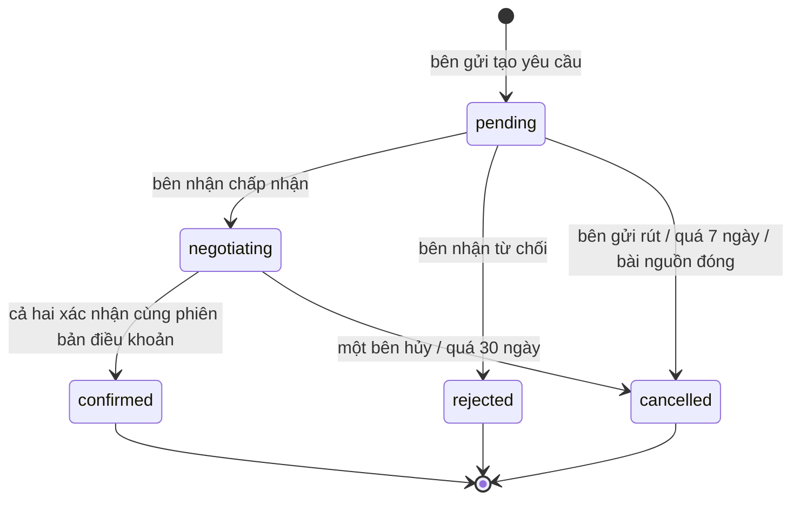

| Từ | Sang | Ai | Điều kiện | Kèm theo |
| -- | ---- | -- | --------- | -------- |
| – | `pending` | Client | Có hồ sơ con; gia sư đã xác minh và đang nhận học sinh; không có yêu cầu mở trùng (gia sư + con + môn, D21) | `expires_at = +7 ngày` |
| – | `pending` | Gia sư | Gia sư đã xác minh; bài tìm gia sư đang `open` | `expires_at = +7 ngày` |
| `pending` | `negotiating` | Bên nhận | | Ghi `accepted_at`; mở hội thoại (D14); `expires_at = accepted_at + 30 ngày` |
| `pending` | `rejected` | Bên nhận | | Có thể kèm lời nhắn |
| `pending` | `cancelled` (`withdrawn`) | Bên gửi | | |
| `pending` | `cancelled` (`expired_pending`) | Hệ thống | Quá `expires_at` | Nhắc bên nhận 24 giờ trước _(D30)_ |
| `pending` | `cancelled` (`source_closed`) | Hệ thống | Bài tìm gia sư nguồn bị đóng hoặc ẩn _(D31)_ | Chỉ áp dụng cho yêu cầu ứng tuyển còn `pending` |
| `negotiating` | `negotiating` | Gia sư hoặc Client | Đề xuất phiên bản điều khoản mới | Xác nhận trên phiên bản cũ mất hiệu lực |
| `negotiating` | `confirmed` | Hệ thống | Phiên bản điều khoản mới nhất có đủ xác nhận của gia sư và client | Trong **một transaction**: ghi `agreed_terms_id`, tạo lớp + ghi danh + mức học phí đầu tiên (D9); mở thông tin liên hệ và danh tính trẻ (D16); đóng bài tìm gia sư nguồn với lý do `found_tutor` _(D31)_ |
| `negotiating` | `cancelled` (`ended_by_party`) | Gia sư hoặc Client | | Hội thoại giữ lại để xem, không gửi thêm tin _(D32)_ |
| `negotiating` | `cancelled` (`expired_negotiating`) | Hệ thống | Quá `expires_at` | Nhắc cả hai bên 3 ngày trước _(D30)_ |
| `pending`, `negotiating` | `cancelled` (`ended_by_party`) | Hệ thống | Một bên bị khóa tài khoản hoặc gia sư bị thu hồi xác minh | |

`confirmed`, `rejected`, `cancelled` là trạng thái cuối. Muốn kết nối lại thì tạo yêu cầu mới.

## B.2. Bài tuyển học sinh (`tutor_posts.status`)

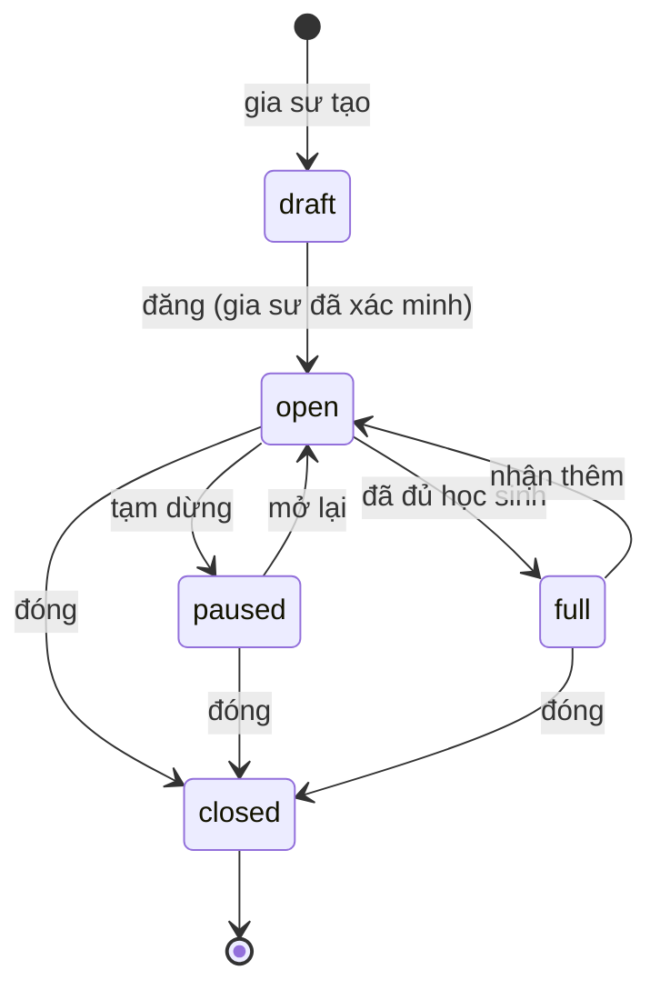

| Từ | Sang | Ai | Điều kiện | Kèm theo |
| -- | ---- | -- | --------- | -------- |
| – | `draft` | Gia sư | Gia sư nào cũng tạo nháp được, kể cả chưa xác minh | |
| `draft` | `open` | Gia sư | `profile_status = verified`, tài khoản `active` (D5) | Ghi `published_at` |
| `open` ↔ `paused` | | Gia sư | | |
| `open` ↔ `full` | | Gia sư | Bản đầu đánh dấu thủ công | |
| `open`, `paused`, `full` | `closed` | Gia sư | | Trạng thái cuối; muốn đăng lại thì nhân bản thành nháp mới _(D33)_ |
| `open`, `full` | `paused` | Hệ thống | Gia sư bị thu hồi xác minh | |
| bất kỳ | xóa mềm | Gia sư | | Ghi `deleted_at` |

**Lớp phủ kiểm duyệt** (độc lập với trạng thái): Manager đặt `moderation_hidden_at` để ẩn bài vi phạm, hoặc bỏ ẩn. Bài chỉ hiển thị công khai khi `status = open`, chưa bị ẩn, chưa xóa, và tài khoản gia sư đang `active`.

## B.3. Bài tìm gia sư (`request_posts.status`)

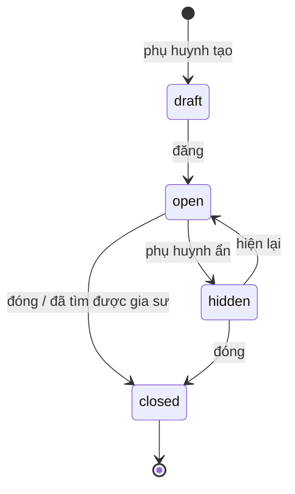

| Từ | Sang | Ai | Điều kiện | Kèm theo |
| -- | ---- | -- | --------- | -------- |
| `draft` | `open` | Client | Gắn với một hồ sơ con, một môn (D25) | Chỉ gia sư đã xác minh và đã đăng nhập thấy (C8) |
| `open` ↔ `hidden` | | Client | | Ẩn thì các yêu cầu ứng tuyển `pending` bị hủy (`source_closed`) _(D31)_ |
| `open`, `hidden` | `closed` | Client | Chọn `closed_reason` | Hủy các ứng tuyển `pending` (`source_closed`) _(D31)_ |
| `open`, `hidden` | `closed` (`found_tutor`) | Hệ thống | Một kết nối từ bài này được xác nhận hợp tác | _(D31)_ |

Lớp phủ kiểm duyệt giống B.2.

## B.4. Hồ sơ gia sư và xác minh

### B.4.1. Hồ sơ (`tutor_profiles.profile_status`)

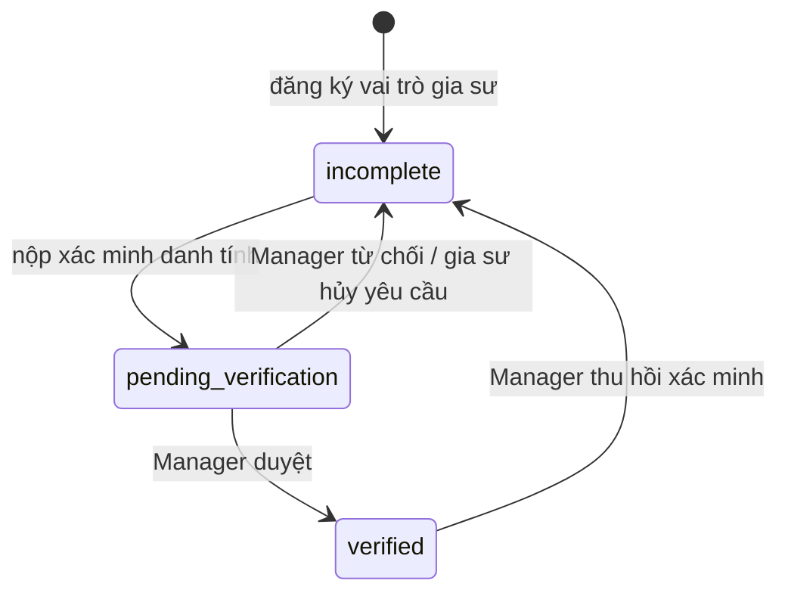

| Từ | Sang | Ai | Điều kiện | Kèm theo |
| -- | ---- | -- | --------- | -------- |
| `incomplete` | `pending_verification` | Gia sư | Đã điền các trường bắt buộc (bắt buộc: họ tên, môn – khối dạy được, hình thức dạy, học phí tham khảo; D34); nộp CCCD hai mặt; nộp thêm thẻ sinh viên nếu `occupation = university_student` (C4) | Tạo `verification_requests` loại `identity`, `review_due_at = +2 ngày làm việc` (D26) |
| `pending_verification` | `verified` | Manager | | Ghi `identity_verified_at`; đặt lịch xóa ảnh giấy tờ sau 30 ngày (C4); ghi audit log |
| `pending_verification` | `incomplete` | Manager | Bắt buộc nêu lý do | Gia sư sửa và nộp lại |
| `pending_verification` | `incomplete` | Gia sư | Hủy yêu cầu đang chờ | |
| `verified` | `incomplete` | Manager | Kết quả một vụ việc kiểm duyệt (giấy tờ giả, mạo danh) | Bài đăng đang mở chuyển `paused`; yêu cầu kết nối đang mở bị hủy; ghi audit log |

Sửa các trường tự khai (giới thiệu, kinh nghiệm, học phí) **không** làm đổi trạng thái. Họ tên thật bị khóa sau khi xác minh; muốn đổi phải xác minh lại _(D34)_. Tình trạng nhận học sinh (`accepting_students`) là cờ riêng, gia sư bật/tắt tự do.

### B.4.2. Yêu cầu xác minh (`verification_requests.status`) và bằng cấp

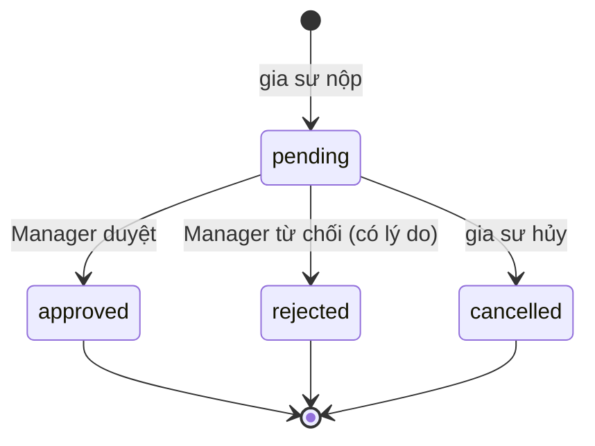

Nộp lại sau khi bị từ chối là **một yêu cầu mới**, để giữ lịch sử từng lần duyệt. Với yêu cầu loại `credential`, kết quả được chép sang `tutor_credentials.verification_status` (`self_declared` → `pending` → `verified` / `rejected`). Duyệt một bằng cấp (`kind = degree`) thì bật `has_verified_degree` (D20).

## B.5. Lớp học và ghi danh

### B.5.1. Lớp (`tutoring_classes.status`)

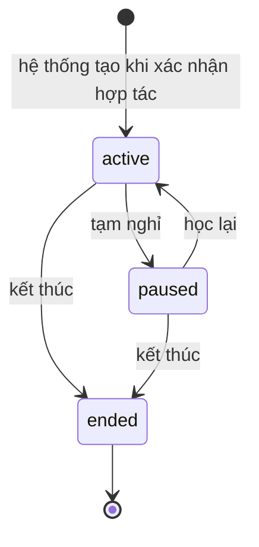

| Từ | Sang | Ai | Điều kiện | Kèm theo |
| -- | ---- | -- | --------- | -------- |
| – | `active` | Hệ thống | Yêu cầu kết nối chuyển `confirmed` (D9) | Tạo ghi danh `active` và mức học phí `active` từ điều khoản đã thống nhất |
| `active` | `paused` | Gia sư _(D35)_ | | Các buổi `scheduled` trong tương lai chuyển `cancelled` (lý do "lớp tạm nghỉ", không tính là hủy muộn); ngừng sinh buổi mới |
| `paused` | `active` | Gia sư _(D35)_ | | Sinh lại buổi học từ hôm nay theo lịch còn hiệu lực |
| `active`, `paused` | `ended` | Gia sư _(D35)_ | Ghi `ended_reason` | Hủy các buổi tương lai; lịch chuyển `ended`; ghi danh chuyển `left`; dữ liệu học tập giữ nguyên để tra cứu (§16.13). Đổi gia sư = kết thúc lớp và kết nối lại (D28) |

`ended` là trạng thái cuối. Phụ huynh không tự tạm nghỉ hay kết thúc lớp: muốn dừng thì trao đổi với gia sư; phụ huynh vẫn hủy được từng buổi học (B.6) _(D35)_.

### B.5.2. Ghi danh (`class_enrollments.status`)

`active` ↔ `paused` → `left`. Với lớp 1-1 (bản đầu), trạng thái ghi danh luôn đi cùng trạng thái lớp. Khi mở lớp nhóm, từng học sinh có thể tạm nghỉ hoặc rời lớp độc lập.

### B.5.3. Mức học phí (`enrollment_fee_rates.status`)

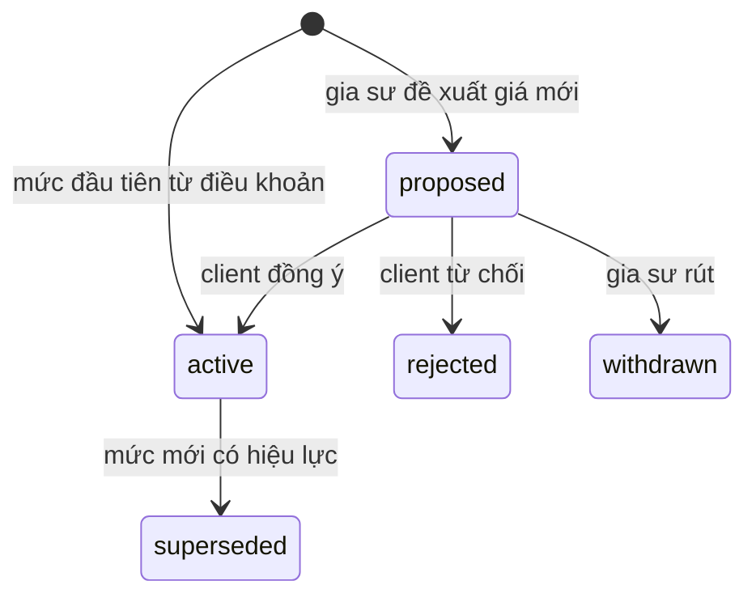

Khi client đồng ý, trong một transaction: mức `active` cũ → `superseded`, mức đề xuất → `active` với `effective_from = now()`. Chỉ các buổi học điểm danh **sau** thời điểm đó dùng giá mới (D17). Mỗi ghi danh có tối đa một mức `active` và một mức `proposed`.

## B.6. Buổi học (`lessons.status`)

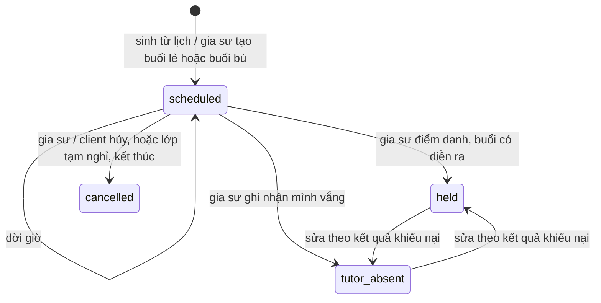

| Từ | Sang | Ai | Điều kiện | Kèm theo |
| -- | ---- | -- | --------- | -------- |
| – | `scheduled` | Hệ thống | Job sinh buổi trong 8 tuần tới (D27) | Không sinh trùng (`schedule_id, occurrence_start`) |
| – | `scheduled` | Gia sư | Buổi lẻ, hoặc buổi bù (`makeup_for_lesson_id` trỏ tới buổi `cancelled` / `tutor_absent`) | |
| `scheduled` | `scheduled` (dời giờ) | Gia sư | Trước giờ bắt đầu | Đổi `starts_at`, `ends_at`; giữ `occurrence_start`; thông báo client |
| `scheduled` | `cancelled` | Gia sư hoặc Client | Trước giờ bắt đầu | `is_late_cancellation = true` nếu báo dưới 2 giờ (C5); không tính tiền |
| `scheduled` | `cancelled` | Hệ thống | Lớp tạm nghỉ hoặc kết thúc | `is_late_cancellation = false` |
| `scheduled` | `held` | Gia sư | Sau giờ bắt đầu | Tạo điểm danh cho từng học sinh (B.7), chụp giá học phí; ghi nội dung đã dạy, thời lượng thực tế |
| `scheduled` | `tutor_absent` | Gia sư | Sau giờ bắt đầu | Tạo điểm danh `not_applicable`, không tính tiền; client vẫn xác nhận |
| `held` ↔ `tutor_absent` | | Hệ thống | Kết quả khiếu nại (B.8) | Cập nhật điểm danh và tiền tương ứng |

Gia sư chưa điểm danh sau giờ kết thúc 24 giờ thì được nhắc _(D36)_. Buổi học không bao giờ tự chuyển `held`: chỉ gia sư mới ghi nhận buổi đã dạy.

## B.7. Điểm danh và xác nhận buổi học (`lesson_attendances`)

**Trạng thái điểm danh** (`status`): `present`, `absent_notified`, `absent_no_show`, `not_applicable` (buổi gia sư vắng). Gia sư ghi khi chuyển buổi sang `held` hoặc `tutor_absent`.

**Trạng thái xác nhận** (`confirmation_status`):

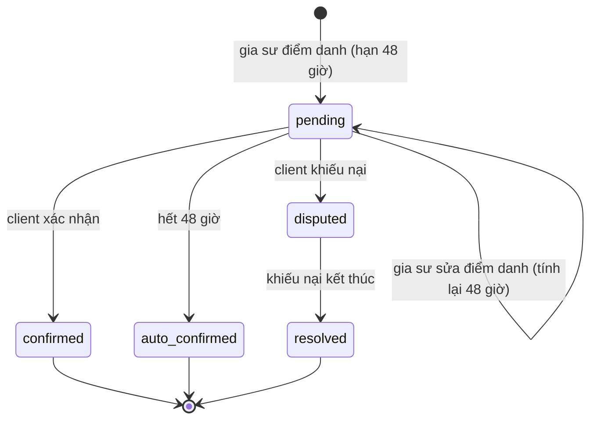

| Từ | Sang | Ai | Điều kiện | Kèm theo |
| -- | ---- | -- | --------- | -------- |
| – | `pending` | Hệ thống | Gia sư điểm danh | `confirm_due_at = recorded_at + 48 giờ` (C5) |
| `pending` | `pending` | Gia sư | Sửa điểm danh trước khi được xác nhận | Đặt lại `confirm_due_at = now + 48 giờ`, thông báo client _(D37)_ |
| `pending` | `confirmed` | Client | Trước `confirm_due_at` | |
| `pending` | `auto_confirmed` | Hệ thống | Hết `confirm_due_at`; đã nhắc client một lần trước hạn (C5) | |
| `pending` | `disputed` | Client | Trước `confirm_due_at` | Tạo khiếu nại (B.8); buổi chưa tính tiền |
| `disputed` | `resolved` | Hệ thống | Khiếu nại kết thúc (B.8) | Điểm danh và `is_billable` đã được sửa theo kết quả |

Sau khi `confirmed`, `auto_confirmed` hoặc `resolved`, bản ghi bị khóa. **Tính tiền** (C5): `is_billable = true` khi và chỉ khi buổi `held` và học sinh `present`. Chỉ buổi đã ở một trong ba trạng thái cuối mới được đưa vào bảng học phí.

## B.8. Khiếu nại buổi học (`attendance_disputes.status`)

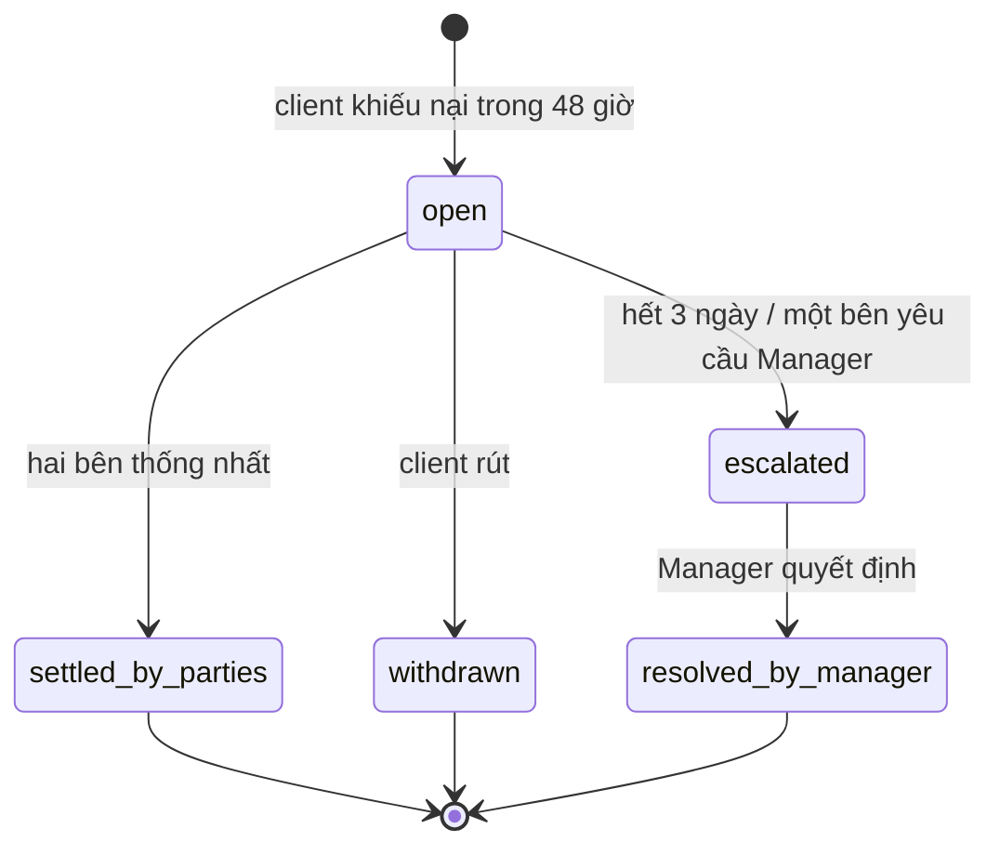

| Từ | Sang | Ai | Điều kiện | Kèm theo |
| -- | ---- | -- | --------- | -------- |
| – | `open` | Client | Xác nhận đang `pending` | `negotiate_until = +3 ngày` (C5); xác nhận → `disputed` |
| `open` | `settled_by_parties` | Gia sư sửa điểm danh, Client chấp nhận | | Xác nhận → `resolved` |
| `open` | `withdrawn` | Client | | Điểm danh giữ như gia sư ghi; xác nhận → `resolved` |
| `open` | `escalated` | Hệ thống (hết `negotiate_until`) hoặc Gia sư / Client yêu cầu sớm _(D38)_ | | Tạo `moderation_cases` loại `session_dispute` |
| `escalated` | `resolved_by_manager` | Manager | | Manager chỉ sửa bản ghi (điểm danh, trạng thái buổi), không hoàn tiền (D6); xác nhận → `resolved`; ghi audit log |

Không đồng ý với quyết định của Manager thì khiếu nại lại lên Admin (B.9). Nếu khiếu nại kết thúc sau khi bảng học phí tháng đã lập, buổi đó được tính vào bảng tháng sau.

## B.9. Báo cáo vi phạm và vụ việc kiểm duyệt

### B.9.1. Báo cáo (`violation_reports.status`)

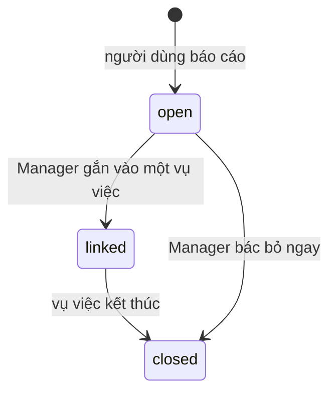

Nhiều báo cáo về cùng một đối tượng có thể gắn vào **một** vụ việc. Người báo cáo được thông báo khi báo cáo đóng, nhưng không được biết chi tiết chế tài áp dụng cho người khác _(D39)_.

### B.9.2. Vụ việc (`moderation_cases.status`)

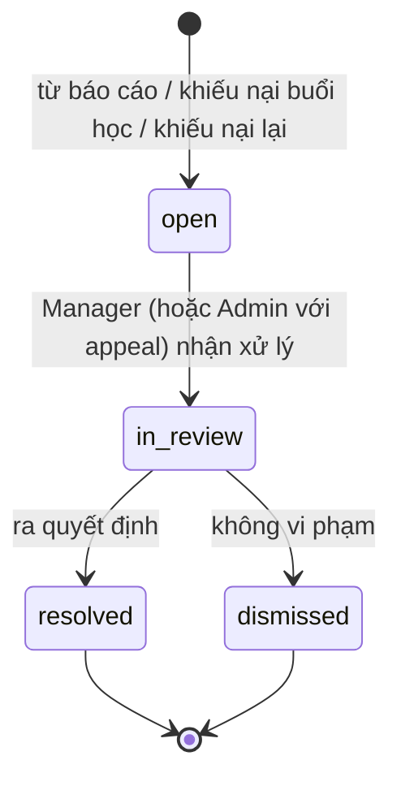

| Từ | Sang | Ai | Kèm theo |
| -- | ---- | -- | -------- |
| – | `open` | Hệ thống | `case_type`: `violation` (từ báo cáo), `session_dispute` (từ B.8), `appeal` (khiếu nại lại) |
| `open` | `in_review` | Manager; **Admin** nếu là `appeal` (C1) | Ghi `assigned_to` |
| `in_review` | `resolved` | Người đang xử lý | Ghi `decision`: `warning`, `content_hidden`, `account_restricted`, `account_locked`, `record_corrected`; tạo `account_sanctions` khi cần; ghi audit log |
| `in_review` | `dismissed` | Người đang xử lý | `decision = no_action` |
| `resolved`, `dismissed` | – (tạo vụ `appeal` mới) | Người bị xử lý hoặc client trong tranh chấp | Trong 7 ngày kể từ quyết định _(D39)_; mỗi vụ chỉ khiếu nại lại một lần _(D39)_ |

### B.9.3. Chế tài và trạng thái tài khoản (`users.status`)

`active` → `restricted` (hạn chế: không đăng bài, không gửi yêu cầu, không nhắn tin mới) → `locked` (không đăng nhập; mọi phiên bị thu hồi). Trạng thái tài khoản là kết quả của các chế tài **đang hiệu lực** trong `account_sanctions`: chế tài hết hạn (`ends_at`) hoặc được gỡ (`lifted_at`) thì job đưa tài khoản về mức nhẹ hơn. Cảnh báo (`warning`) không đổi trạng thái tài khoản.

## B.10. Học phí tháng và thanh toán

### B.10.1. Bảng học phí (`fee_statements.status`)

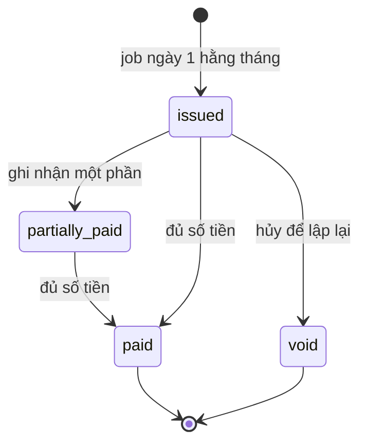

| Từ | Sang | Ai | Điều kiện | Kèm theo |
| -- | ---- | -- | --------- | -------- |
| – | `issued` | Hệ thống | Ngày 1 hằng tháng, cho tháng trước, mỗi ghi danh một bảng (D23) | Gom các buổi đã chốt chưa thuộc bảng nào; `due_date` = ngày 5 (D24); thông báo client |
| `issued` | `partially_paid` / `paid` | Hệ thống | Tổng thanh toán **đã được bên kia xác nhận** đạt một phần / đủ _(D41)_ | |
| `issued` | `void` | Gia sư | Chưa có thanh toán nào được xác nhận; ghi lý do | Các buổi được trả lại để lập bảng mới |

Trạng thái `draft` có trong thiết kế nhưng chưa dùng ở bản đầu: bảng được phát hành ngay. Điều chỉnh (giảm giá, phụ thu) nếu có thì thêm dòng `adjustment` vào bảng tháng sau _(D40)_.

### B.10.2. Thanh toán (`payments.status`)

`recorded` (một bên ghi nhận) → `acknowledged` (bên còn lại xác nhận) hoặc `voided` (bên ghi nhận hủy khi chưa được xác nhận). Chỉ thanh toán `acknowledged` mới được cộng vào `paid_amount_vnd` _(D41)_: tránh trường hợp một bên tự ghi "đã trả" mà bên kia không nhận được.

---

# Phần C. Quy tắc bổ sung đã chốt

Các quy tắc sau được bổ sung khi vẽ sơ đồ và đã được chủ dự án duyệt ngày 2026-11-12 (chi tiết trong [decision log](00-product/decision-log.md)).

| Mã | Quy tắc | Ở mục |
| -- | ------- | ----- |
| D30 | Nhắc bên nhận 24 giờ trước khi yêu cầu `pending` hết hạn; nhắc cả hai bên 3 ngày trước khi `negotiating` hết hạn | B.1 |
| D31 | Bài tìm gia sư bị ẩn hoặc đóng thì các ứng tuyển còn `pending` tự hủy; khi xác nhận hợp tác từ bài đó, hệ thống tự đóng bài (`found_tutor`) | B.1, B.3 |
| D32 | Hủy khi đang trao đổi thì hội thoại chỉ còn xem được, không gửi thêm tin | B.1 |
| D33 | Bài tuyển học sinh đã đóng là trạng thái cuối; muốn đăng lại thì nhân bản | B.2 |
| D34 | Trường bắt buộc trước khi nộp xác minh: họ tên, môn – khối dạy được, hình thức dạy, học phí tham khảo. Họ tên thật khóa sau khi xác minh | B.4 |
| D35 | **Chỉ gia sư** được tạm nghỉ, học lại, kết thúc lớp. Tạm nghỉ hủy các buổi tương lai, học lại sinh lại buổi. Phụ huynh muốn dừng thì trao đổi với gia sư; phụ huynh vẫn hủy được từng buổi học | B.5 |
| D36 | Nhắc gia sư điểm danh nếu sau giờ kết thúc buổi 24 giờ chưa ghi | B.6 |
| D37 | Gia sư sửa điểm danh khi chưa được xác nhận thì hạn 48 giờ tính lại từ đầu | B.7 |
| D38 | Một bên được chuyển khiếu nại lên Manager trước khi hết 3 ngày | B.8 |
| D39 | Khiếu nại lại quyết định kiểm duyệt trong 7 ngày, mỗi vụ một lần; người báo cáo không được biết chi tiết chế tài | B.9 |
| D40 | Bảng học phí phát hành ngay ngày 1, không qua nháp; điều chỉnh đưa vào tháng sau | B.10 |
| D41 | Chỉ thanh toán đã được bên kia xác nhận mới được tính là đã trả | B.10 |
